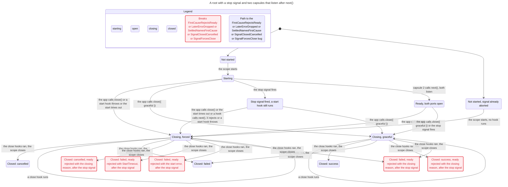
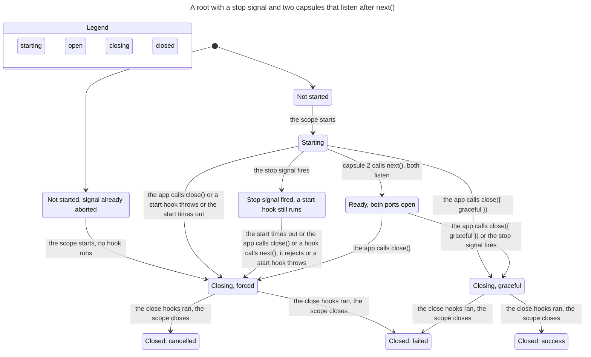
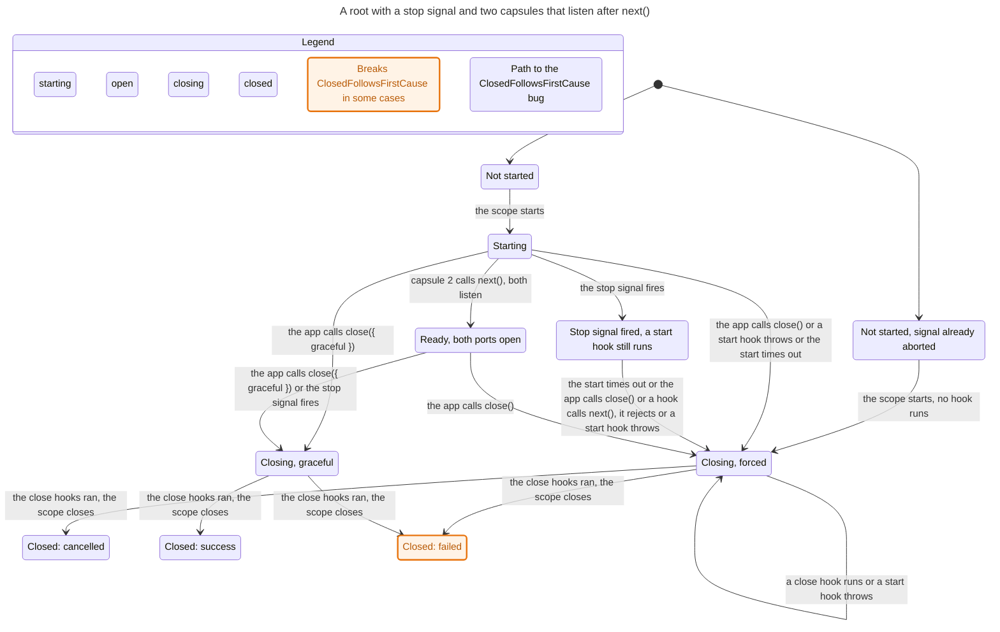

# 0165 Settled is the twin of ready

Date: 2026-11-21. Status: accepted (Duke,
2026-11-21 08:26 UTC).
Amends: ADR 0134 decision 2 (which cause `ready`
reports).
Fixes: bug 3 in
[scope-life](../states/scope-life/README.md)
(card `core/stop-signal-then-later-event`).

## Precedent

- Core's own `run` and `settle`: `run` throws,
  `settle` gives a union of the outcomes.
- Zod: `parse` throws, `safeParse` gives
  `{ success, data }` or `{ success, error }`.
- `Promise.allSettled`: each result is a union,
  and the promise never rejects.
- Core's `closed` already never rejects
  (ADR 0085).

Tinker keeps the same pair for a start:
`ready` throws, `settled` gives the union.

## Context

A start can end several ways at once:

- the stop signal fires;
- a start hook throws;
- the start times out;
- the app calls `close()`.

ADR 0134 d2 does not say which cause `ready`
reports when two come.
Today the last event wins (bug 3).
So a stop signal, then a hook's throw, rejects
`ready` with the throw, and `closed` is `failed`,
not `cancelled`.

A caller that wants the outcome, not a throw,
has no tool for it.
`scope.settled()` is taken: it waits until the
scope's in-flight work ends.

## Decision

1. **`settled` is a promise, the twin of `ready`.**
   - `scope.settled` is a property, as `ready` is.
   - It never rejects.
   - It resolves to one of:
     - `{ status: "success", handle }`;
     - `{ status: "cancelled", reason }`;
     - `{ status: "failed", error }`.
   - `handle` is what `ready` resolves to.
2. **The first cause wins.**
   - The first event that ends the start is its
     cause: a stop signal, a start hook's throw,
     a start timeout, or a `close()`.
   - `ready` rejects with that cause.
     `settled` names the same cause.
   - A later error is dropped.
     There is no list of causes.
   - This amends ADR 0134 d2. Its "a start error
     that comes first still wins" now holds for
     every cause, in both orders.
   - `closed` names the same first cause
     (Duke, 2026-11-21 14:58 UTC).
     A `close()` first, then a start error:
     `settled` and `closed` are both `cancelled`.
     A graceful close stays `success` (ADR 0028).
     The later error is not in `teardownErrors`:
     it is a start error, not a cleanup throw
     (ADR 0027), and a later error is dropped.
3. **The old `settled()` is now `idle()`.**
   - `handle.idle()` waits until the scope's
     in-flight work ends, as `settled()` did.
   - Same behavior, new name.
   - Core's tests, skills and docs use the new name.

## Chart

The [scope-life](../states/scope-life/README.md)
spec on main: each red state is bug 3,
a stop signal and then a later event that wins.

After the fix, every event after the stop signal
leads to the forced close, and no red state is left:

The amend to d2 (`closed` names the first cause),
on main before its fix.
Orange: `Closed: failed` breaks
ClosedFollowsFirstCause in some cases.
The path: the scope starts,
the app calls `close()`,
the close hooks run,
a start hook throws,
and the scope closes `failed`.

## Results

- Bug 3's path test moves into Core's tests, red
  on main first, and passes after the fix.
- A minor version: the API changes.
- Apps that call `.settled()` rename it to
  `.idle()` (Hedl: its test uses).
