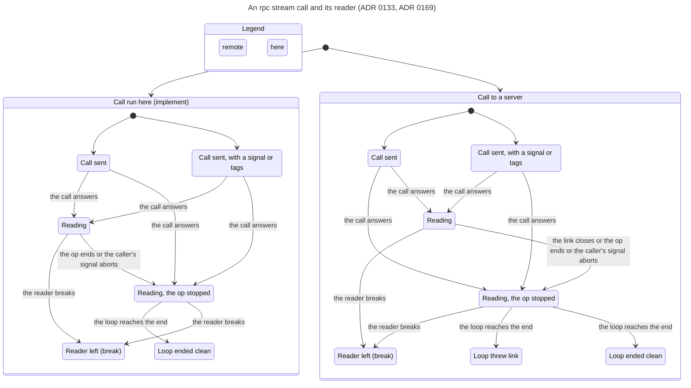

# 0169 A stream call keeps its signal and tags for its stream

Date: 2026-11-22. Status: accepted; built.
Accepted: Duke, 2026-11-22 14:57 UTC, option A
(the fetch rule; B: the session owns the stream;
C: no signal and no tags on a stream).
Refines: ADR 0090 (call signal), ADR 0133 d4.
Card `core/stream-call-session`.
Closes card `core/local-stream-signal`.

## Context

A call with a `signal` or `tags` runs in its own
child session (ADR 0038, ADR 0090).
That session ends when its body returns,
as a transaction callback does (ADR 0071).

An rpc stream call returns a reader.
So its session ended at the answer,
while the stream still had work to do.

On main `d795143` (and `74211a57`), any stream call
with a `signal` or `tags` broke:

- remote: the session's end stopped the watch.
  A server that sent 1, 2, 3 gave the reader `[1]`.
- here (`implement`): the call waited for the op.
  An op that waits on `closed` never answered.

```ts
const values = await tab.run(api.ticks, {
  input: null,
  signal: stop.signal,
});
for await (const n of values) seen.push(n);
// before: seen = [1] (remote), or no answer (here)
```

ADR 0133 d4 said
"the caller's signal already stops it".
The code stopped it at the answer.

## Precedent

- **fetch.** `fetch(url, { signal })` answers
  with the headers.
  The signal then stops the body stream too.
  The body lives with its reader,
  not with the `fetch` call.
- **ADR 0090.** "An already-aborted signal starts
  no body."

## Decision

1. A call to an rpc stream key opens no child
   session for its `signal` or `tags`.
   The call answers with the reader at once.
   The stream lives with the caller's owner,
   as a call with neither does.
2. The caller's `signal` stops the stream,
   as a `break` does.
   The reader's loop ends clean
   (ADR 0133 d1: it is a cancellation).
3. The call's `tags` are the first tags
   of the call's rpc lifecycle (`onStart` and the rest).
   Its hooks read them,
   and they bind the stream's own run:
   the watch on a client, the op here.
   A hook's own tags come after them,
   as they came inside the call session before.
4. A `signal` that already aborted starts nothing.
   The reader ends at once, with no value.
5. The listener on the caller's signal goes
   when the reader leaves.

## Chart

The rpc-stream spec with this rule
(0 breaks, 394 states).



## Not done here

- Other ops keep ADR 0090 as it is.
- A plain op that returns a live value
  from a call session still loses it.
  No case asks for that yet.

## Proof

- Backend kit (memory and ws):
  a stream with a signal reads `[1, 2, 3]`,
  then the signal ends it,
  and the server's op ends.
  The same with `tags` and a `break`.
  An aborted signal reads nothing,
  and the server runs nothing.
- `tests/statechart/rpc-stream-paths.test.ts`:
  a stream run here with a signal answers at once,
  and the signal ends it clean.
- A stream run here with tags answers at once,
  and its op reads the tags.
- A stream call's tags reach its `onStart`,
  here and remote.
- Each test fails on `74211a57`.
- Spec [rpc-stream](../states/rpc-stream/README.md):
  before, 3 rules break (411 states);
  after, 0 (394 states).
