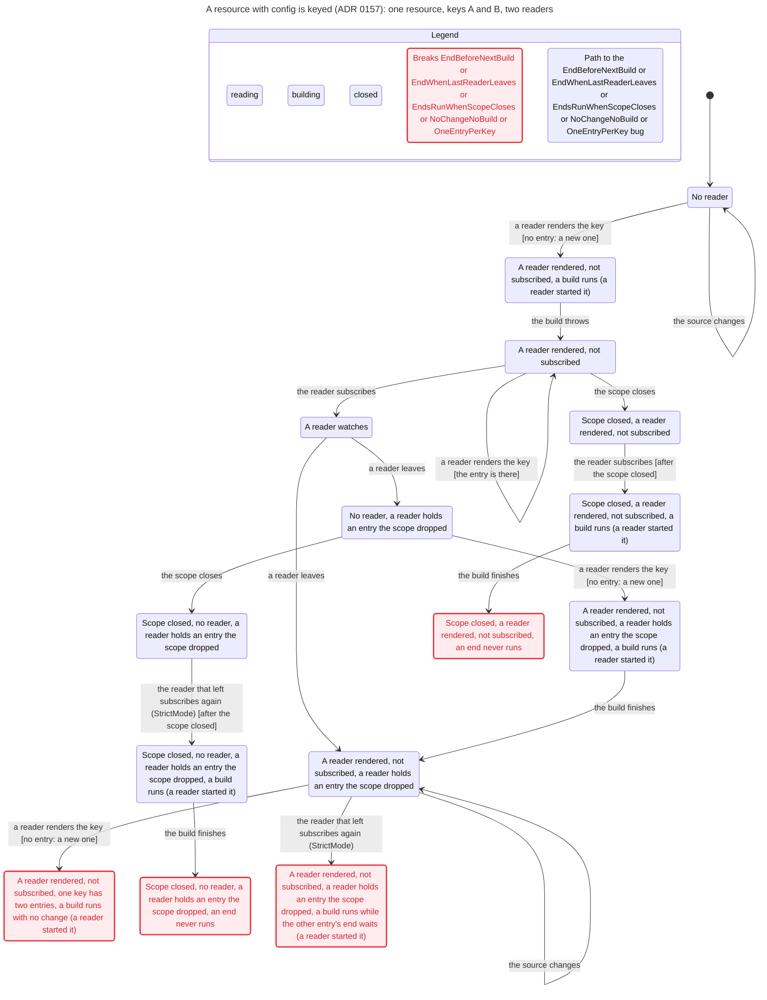

# keyed-resource

A resource with config is keyed
([ADR 0157](../../decisions/0157-a-resource-with-config-is-keyed.md)).

The spec: one resource with config, keys A and B,
two readers, one source cell, three entry objects.
It describes commit `3ff6778` (release 0.28.0):

- `packages/core/src/index.ts`:
  `builtReader` and `class BuiltEntry`.
- `packages/react/src/index.ts`: `useData`.

Words:

- **entry** — the one object (`BuiltEntry`)
  that holds a key's build.
  The scope keeps a map from key to entry.
- **reader** — React's `useData`.
  It renders (resolve, then `get`),
  subscribes (`watch`), and leaves
  (the stop from `watch`).

## Rules

TLC reached 24,044 states.
The spec, the chart and the rerun
still describe `3ff6778`, before fix `ff565316`.
So they still show 5 rules break.

- **EndBeforeNextBuild** — breaks.
  ADR 0157 d5.
  An end runs before the next build of the same key.
- **EndWhenLastReaderLeaves** — holds after fix `ff565316`
  (card `core/keyed-watch-after-close`).
  ADR 0157 d5.
  A key with no reader has no end that waits.
- **EndsRunWhenScopeCloses** — holds after fix `ff565316`
  (card `core/keyed-watch-after-close`).
  ADR 0157 d5.
  After the scope closed, no end waits.
  It holds on the paths the spec covers
  (paths 3 and 4).
  Not covered: a source still pending
  that settles after the close
  (`park`, then `tell`, `wake`, `fresh(true)`).
  Card `core/keyed-wake-after-close` follows it.
- **EndsRunLastFirst** — holds.
  ADR 0157 d5.
  Ends run last first.
  The spec copies the code's order,
  so this check cannot fail.
  `resource-keyed-life.test.ts` ("last first")
  pins it.
- **NoChangeNoBuild** — breaks.
  ADR 0157 d4.
  A read with no change makes no build (span).
- **NoWriteInRead** — holds.
  ADR 0157 d7, ADR 0152 d7.
  A build a reader starts writes no cell.
- **OneEntryPerKey** — breaks.
  ADR 0150 d5.
  One entry per key;
  every reader of a key shares it.
- **NoReaderNoEntry** — holds.
  ADR 0150 d5.
  The last reader leaves, the entry goes.
- **NoDeadlock** — holds. From the tool.

ADR 0150 d5 counts here:
ADR 0157 changes ADR 0150 only in the name
and the write rule.

## Chart

Over 500 states, so the chart draws
only the bug paths.



Which state breaks which rule:

- s9: NoChangeNoBuild and OneEntryPerKey.
- s14: EndBeforeNextBuild.
- s11: EndsRunWhenScopeCloses.
- s13: EndWhenLastReaderLeaves
  (and EndsRunWhenScopeCloses).

## Bugs

Two causes:

- **Cause A** (bug 1, card `core/keyed-entry-dropped`).
  A reader subscribes to an entry
  the scope already dropped.
  The entry left the map when its last watcher left,
  but React still holds it.
  So the next reader of that key gets a second entry.
- **Cause B** (bug 2, card `core/keyed-watch-after-close`).
  A held reader subscribes after the scope closed.
  `watch()` runs `fresh()` (a build)
  before the source's watch throws `Disposed`.
  That build's end never runs.
  The close also frees the store,
  so the build reads the cell's first value (0).
  A `get()` after the close had the same hole.
  Fix `ff565316`: `get()` and the first `watch()`
  throw `Disposed` before they build.

### Path 1: NoChangeNoBuild and OneEntryPerKey

Cause A.

1. Reader 1 renders key A.
   There is no entry, so a new one builds.
2. The build throws.
3. Reader 2 renders key A. The entry is there.
4. Reader 2 subscribes.
5. Reader 2 leaves.
   The map drops the entry,
   but reader 1 still holds it.
6. Reader 2 renders key A.
   There is no entry in the map,
   so a second entry builds with no change.

### Path 2: EndBeforeNextBuild

Cause A.

1. Reader 1 renders key A. A new entry builds.
2. The build throws.
3. Reader 1 subscribes.
4. Reader 1 leaves. The map drops the entry.
5. Reader 2 renders key A. A new entry builds.
6. The build finishes. It defers "end 2".
7. The source changes.
8. Reader 1 subscribes again (StrictMode remount).
   Its old entry builds key A
   while "end 2" has not run.

### Path 3: EndsRunWhenScopeCloses

Cause B.

1. The source changes.
2. Reader 1 renders key A. A new entry builds.
3. The build throws.
4. The scope closes.
5. Reader 1 subscribes after the scope closed.
   A build runs, then `watch` throws `Disposed`.
6. The build finishes. Its end never runs.

### Path 4: EndWhenLastReaderLeaves

Cause B.

1. The source changes.
2. Reader 1 renders key A. A new entry builds.
3. The build throws.
4. Reader 1 subscribes.
5. Reader 1 leaves.
6. The scope closes.
7. Reader 1 subscribes again after the scope closed.
   A build runs, then `Disposed`.
8. The build finishes.
   Key A has no reader, and its end waits forever.

### Cause A in real React

- **StrictMode.**
  StrictMode subscribes, leaves,
  then subscribes again with the same store.
  The second subscribe uses the dropped entry.
  A second reader of key A then builds again
  with no change.
- **No StrictMode, a page swap.**
  Page 1 and page 2 both read key A.
  React renders page 2 first,
  so it gets the entry.
  Then page 1's cleanup runs,
  and the map drops the entry.
  Then page 2 subscribes to the dropped entry.
  A later reader C builds key A again
  with no change.

The second entry heals at the stale reader's
next render.
Until then, each source change builds the key
twice (two spans).

Cause B needs the core API
(a reader held past the close).
In React, a render after the close
throws `Disposed` first.

## Path tests

- `keyed-resource-paths.test.ts` —
  paths 3 and 4 (cause B), now in
  `packages/core/tests/statechart/`.
  They pass after fix `ff565316`.
  They failed before: that showed the bug.
  They left the `.txt`,
  so each test lives in one place.
- `paths/keyed-resource-paths.test.ts.txt` —
  paths 1 and 2 (cause A), Core.
  Today: 2 of 2 fail. A fail shows the bug.
  They go into the same
  `packages/core/tests/statechart/keyed-resource-paths.test.ts`,
  since they share `setup` and `renders`.
- `paths/keyed-resource-react.test.tsx.txt` —
  cause A in React.
  Today: 2 of 2 fail.
  Goes to `packages/react/tests/statechart/`.

Card `core/keyed-entry-dropped` moves
the React file, without the `.txt`.
It adds paths 1 and 2 to the Core file
above, not to a new file.

Run:

```sh
cd packages/core
vp test tests/statechart/keyed-resource-paths.test.ts
```

Once the React file moves, run:

```sh
cd packages/react
vp test --project browser \
  tests/statechart/keyed-resource-react.test.tsx
```

## What the spec leaves out

- Async sources (`park`, `wait`, `failed`).
- A build that writes its own source,
  and the round limit `UpdateDepth` (ADR 0152 d6).
- An end that throws;
  a factory that throws after a defer.
- The order of ends across keys at close.
  No ADR says which order applies.
- React re-renders. A re-render moves
  a stale reader to the map's entry.
- `depends` readers. The spec treats them
  as readers that render and never subscribe.
  No ADR says when they leave.
- A render React throws away before commit
  (`get` with no `watch`).
  It leaves an entry in the map until the close.
  No ADR covers it.
- An entry stays in the scope's close list
  after its last reader leaves
  (`hooked` is never cleared).
  One closure per entry until the close.
- Spans as objects:
  each build counts as one span.
- `close({ withData: true })` and sessions.

## Rerun

```sh
cd docs/states/keyed-resource
statechart KeyedResource.tla \
  --config KeyedResource.cfg \
  --view view.ts --out "$(mktemp -d)"
```

Exit 1: 5 rules break.
The spec still describes `3ff6778`,
so it does not see fix `ff565316`.
In the code, 3 rules break.
