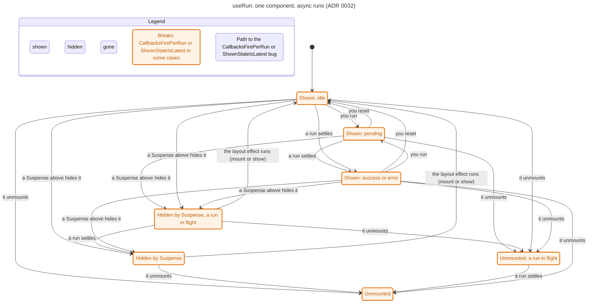
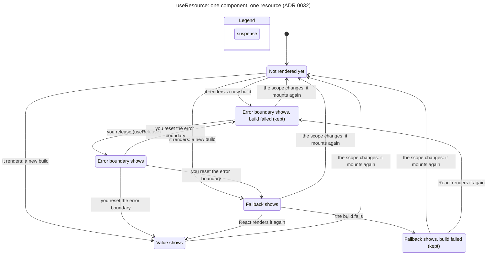
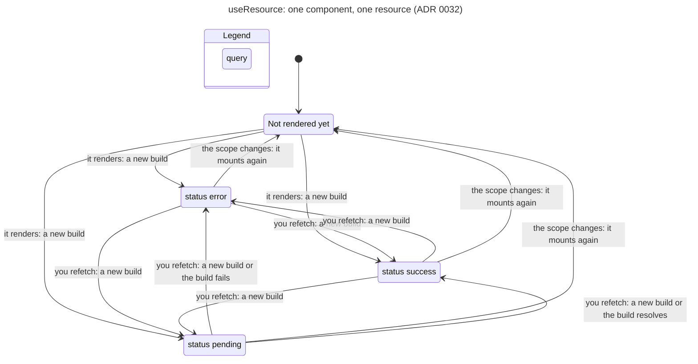

# react-run-resource

Resources suspend, operations are imperative
([ADR 0032](../../decisions/0032-resources-suspend-operations-are-imperative.md)).
`useData` holds its scope;
a new scope mounts the subtree again
([ADR 0144](../../decisions/0144-usedata-holds-its-scope-a-new-scope-mounts-the-subtree-again.md)).

Two specs on `packages/react/src/index.ts`
at commit `c9c8817` (its lines match `3ff6778`).
`useRun` and `useResource` share no state,
so each has its own spec.

- **UseRun** — `RunOwner` 799 (`attach` 828,
  `reset` 848, `finish` 859, `invoke` 872),
  `useRun` 913.
  View: `run-view.ts`. Chart: `chart-run.mmd`.
- **UseResource** — `ResourceOwner` 495
  (`refetch` 520, `effect` 527, `query` 556),
  `useResource` 615, `readSuspended` 666,
  `readQuery` 684.
  View: `resource-view.ts`.
  Two configs, one per mode:
  - `UseResource-suspense.cfg` —
    `chart-suspense.mmd` draws it.
  - `UseResource-query.cfg` —
    `chart-query.mmd` draws it.

## UseRun

The spec: one component, async runs only,
at most 2 runs and resets.
A Suspense above it can hide it
and show it again. It can unmount.

### Rules

TLC reached 158 states.
The spec, the chart and the rerun
still describe `c9c8817`,
before the bug 15 and 16 fix.
So they still show 2 rules break.

- **CallbacksFirePerRun** — holds,
  since `69b47beb`
  (card `react/use-run-hidden`).
  ADR 0032 d2
  ("`options.onSuccess/onError/onSettled`
  fire per run").
- **ShownStateIsLatest** — holds,
  since `69b47beb`
  (card `react/use-run-hidden`).
  ADR 0032 d2
  (shaped like react-query's `useMutation`;
  "the outcome lands in state,
  `variables` is the call").
- **NoDeadlock** — holds. From the tool.

A second run while one runs:
the older run's state is dropped,
and its callbacks fire.
Both rules hold on that path.

### Chart



Every state may break a rule:
once a run's callbacks are lost,
CallbacksFirePerRun stays broken.
The bad steps:

- "a run settles" out of s4 and s5
  breaks CallbacksFirePerRun.
- "the layout effect runs" out of s5
  breaks ShownStateIsLatest.

### Bug 15: a hide and show clears a run to `idle`

Card `react/use-run-hidden` fixes it
(`69b47beb`).
Rule: ShownStateIsLatest.
The text below names the code before the fix.

The fix: `attach` keeps the state.
A detached owner still writes its state,
but calls no React update.
On show, `attach` renders a state
written while it was detached.

On show, `attach` (830) resets
any state that is not `idle`.

#### Path 1: a Suspense hide and show

1. You run: `pending`.
2. A Suspense above hides it.
   Its layout cleanup runs.
3. It shows again.
   `attach` resets the state.
   The status is `idle`, while the run still runs.
   ADR 0032 d2 wants `pending`.

### Bug 16: `onSuccess` is lost

Card `react/use-run-hidden` fixes it
(`69b47beb`).
Rule: CallbacksFirePerRun.
The text below names the code before the fix.

The fix: `finish` calls `notify`
while hidden and after unmount.
An op change drops the old owner's options,
so its callbacks stay off.

`finish` (867) calls `notify`
only while `live`.

#### Path 2: the run ends while hidden

1. You run (`runAsync`).
2. A Suspense above hides it.
3. The run settles.
   `runAsync` gets the value.
   `onSuccess` never fires.
   ADR 0032 d2 wants it to fire.

#### Path 3: the run ends after unmount

1. You run (`runAsync`).
2. It unmounts.
3. The run settles.
   `onSuccess` never fires.

Note for Duke: the doc comment on `useRun` said
a changed provider or op "stops the old owner's
... callback writes".
That is the code's own choice.
In react-query, `useMutation`'s own callbacks
still fire after unmount;
only the per-call ones do not.
The fix keeps it for an op change.
A provider change mounts the subtree again
(ADR 0144 d2), so `useRun` unmounts:
the old run's callbacks now fire.
The test
"switching providers mounts the view again"
says so.
A StrictMode replay is a hide and show,
so it keeps its run now.

## UseResource

The spec: one component, one resource.
A build is sync or async, and may fail.
A failure, then a retry. A refetch.
A scope change mounts it again.

### Rules

TLC reached 34 states (suspense)
and 22 states (query).
All rules hold.

- **FailedBuildSticks** — holds. ADR 0032 d1
  (a rejected build stays until release).
- **FailedNeverHangs** — holds. ADR 0032 d1
  (a retry reuses the rejection,
  never a fallback that hangs).
- **QueryNeverSuspendsOrThrows** — holds.
  ADR 0032 d3.
- **NoOldScopeResult** — holds, but weak.
  ADR 0144 d2.
  The spec copies the observer's cleanup,
  so this check cannot fail.
- **NoDeadlock** — holds. From the tool.

Core's sticky build is copied from the ADR,
not from Core's code.
The tests `use-resource-error`, `use-release`
and `use-resource-query` cover it.
Nothing breaks, so there is no path test.

### Chart: suspense mode



### Chart: query mode



Steps the charts do not draw:

- "you reset the error boundary"
  on a kept failed build:
  it shows the boundary again.
- "the build resolves" under the fallback:
  the same label until React renders again.

## Path tests

- `use-run-paths.test.tsx` —
  paths 1 to 3,
  now in `packages/react/tests/statechart/`.
  All 3 pass since `69b47beb`.
  They failed before: that showed bugs 15 and 16.

Card `react/use-run-hidden`
moved the file in, without the `.txt`.

Run:

```sh
cd packages/react
vp test --project browser \
  tests/statechart/use-run-paths.test.tsx
```

## What the specs leave out

- StrictMode replays
  (the same as a hide and show for `attach`).
- Sync runs, `reset` from inside the op,
  a change of op.
- Renders that React throws away
  (fields written in render:
  `owner.options`, `owner.pending`).
- Query mode: the one commit of `pending`
  for a build that already settled.
- Two components on one resource; `ns`.

## Rerun

```sh
cd docs/states/react-run-resource
statechart UseRun.tla \
  --config UseRun.cfg \
  --view run-view.ts --out "$(mktemp -d)"
statechart UseResource.tla \
  --config UseResource-suspense.cfg \
  --view resource-view.ts --out "$(mktemp -d)"
statechart UseResource.tla \
  --config UseResource-query.cfg \
  --view resource-view.ts --out "$(mktemp -d)"
```

- `UseRun.cfg`: exit 1 today, 2 rules break.
  The spec still describes `c9c8817`,
  so it does not see the bug 15 and 16 fix.
- Both `UseResource` configs: exit 0,
  every rule holds.
