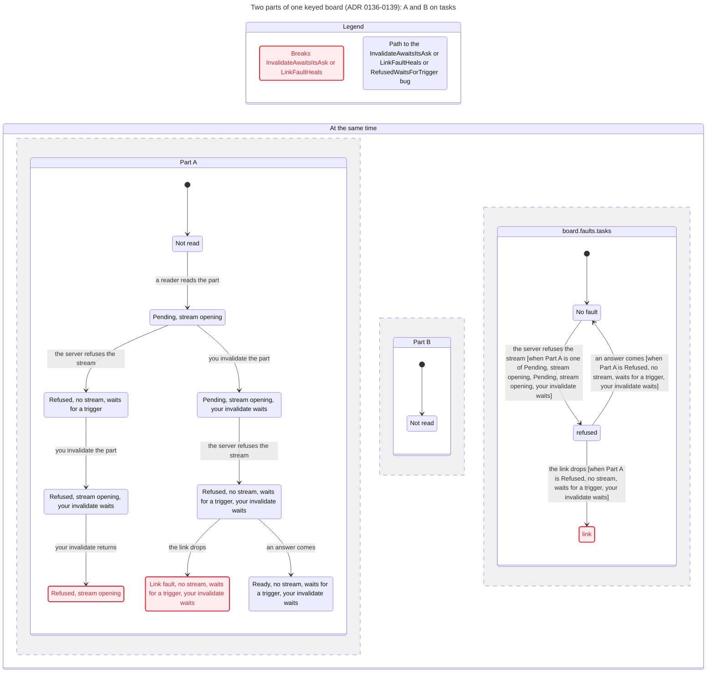
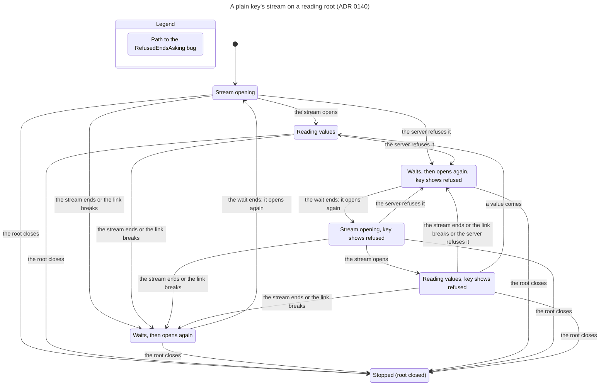

# remote-part

Keyed reads follow TanStack Query
([ADR 0139](../../decisions/0139-keyed-reads-follow-tanstack-query.md)).
The client asks for a part; invalidate asks again
([ADR 0137](../../decisions/0137-the-client-asks-for-a-part-invalidate-marks-it-dirty.md)).
A fault says who spoke
([ADR 0141](../../decisions/0141-a-fault-says-who-spoke.md)).
The protocol lives in each backend
([ADR 0140](../../decisions/0140-the-protocol-lives-in-each-backend.md)).
To see your own write, await `invalidate`
([ADR 0147](../../decisions/0147-the-execution-id-a-call-ends-at-its-reply.md)
d4).

Two specs, both on `packages/core/src/remote-data.ts`
at commit `c9c8817` (its lines match `3ff6778`):

- **RemotePart** — the parts of one keyed board.
  `readKeyed` 755, `stand` 770, `ask` 789,
  `settle` 797, `apply` 828, `reask` 844,
  `parked` 858, `follow` 866, `listen` 924,
  `mark` 591.
- **KeyStream** — the stream of one plain key
  (not keyed) on a reading root.
  `round` 620, `loop` 663.

Three configs:

- `RemotePart.cfg` — every RemotePart rule.
  `chart.mmd` draws it.
- `holds.cfg` — only the rules that hold.
  The main run stops at 100,000 states
  after the first break,
  so this run checks them in full.
  It draws no chart: 340,989 states.
- `KeyStream.cfg` with `key-view.ts` —
  `chart-key.mmd` draws it.

Words:

- **part** — one keyed read,
  such as `tasks.where({ project })`.
- **trigger** — `invalidate`, the board's time,
  or a server signal.
- **parked** — a part whose stream got a fault
  that is an answer.
  It has no stream and waits for a trigger.

## RemotePart

The spec: one keyed board, key `tasks`.
Parts A and B on that key, with no member shared.
Up to 2 readers in all. At most 2 asks.
The link drops at most once.
No `refetchInterval`.

### Rules

TLC reached 340,989 states (`holds.cfg`).
The spec, the chart and the rerun
still describe `c9c8817`,
before the bug 11 fix.
So they still show 3 rules break.

- **RefusedWaitsForTrigger** — holds,
  except one new step:
  on a link fault, a parked, refused part
  shows `link` and opens again
  (ADR 0139 d4: the backend heals a link).
  A spec update must allow it.
  Since `fb7679b4` and `ee58cbaa`
  (card `core/remote-parked-part-wakes`).
  ADR 0139 d4 ("the part goes to fault
  and waits for a trigger");
  ADR 0140 (The direction).
- **LinkFaultHeals** — holds,
  since `fb7679b4` and `ee58cbaa`
  (card `core/remote-parked-part-wakes`).
  ADR 0139 d4 ("the backend heals it;
  the part shows link until then");
  ADR 0141 table ("A link on a read heals:
  the backend watches again").
- **InvalidateAwaitsItsAsk** — breaks.
  ADR 0147 d4 ("To see your own write,
  invalidate", with `await`);
  ADR 0137 d2 (invalidate asks again).
- **PartInUseHasState** — holds. ADR 0139 d1.
- **NothingForNoReader** — holds.
  ADR 0136 d3, ADR 0138 d16.
- **LastAskWins** — holds, but weak.
  ADR 0137 d3.
  The spec copies the code's `later` list,
  so this check cannot fail.
- **NoDeadlock** — holds. From the tool.

### Chart



The spec has more than 500 states,
so the chart draws only the bug paths.

- s6 breaks InvalidateAwaitsItsAsk.
- s7 and s12 break LinkFaultHeals.
- The step into s8 breaks RefusedWaitsForTrigger.
  It is a step rule,
  so the chart marks the path, not the state.

### Bug 11: a parked part wakes from a late answer

Card `core/remote-parked-part-wakes` fixes it
(`fb7679b4`, `ee58cbaa`).
Rules: RefusedWaitsForTrigger, LinkFaultHeals.
One cause, two rules.
The text below names the code before the fix.

The fix is in `apply`, `stand` and `parked`.

- When each part an answer is for is parked,
  or rides a parked part,
  the answer does not get in.
  The parts stay in their fault.
- A link fault is the one exception.
  `apply` wakes the parts,
  and they show `link`.
  Their streams open again,
  with back-off while the link is down.
  When the link is back, a stream opens,
  and its first signal asks.
- An answer that a live part shares
  gets in, but `stand` skips each part
  that is parked or rides a parked part.
  Those keep their fault.
- A wake clears `wake` at once,
  so a woken part shows `link` at once,
  or when its stream open fails.

Tests: `packages/core/tests/`
`remote-data-keyed-parked.test.ts`
(a rider; a live part that holds a parked one).

The spec's RefusedWaitsForTrigger
lets a parked, refused part
go only to refused or none.
The fix also lets it go to `link`,
as the LinkFaultHeals path test wants
(step 4 of path 2).
A spec update must allow that step.

`apply` (828) runs on a parked part.
`settle` checks only `newer` and `inUse` (822).
It does not look at `wake`,
so it does not see that the part is parked.

#### Path 1: refused turns ready

1. A reader reads part A.
   Pending, stream opening.
2. You invalidate part A.
   The stream is not open,
   so `reask` asks now (844-853).
3. The server refuses the stream.
   A parks: refused.
4. The ask's answer comes.
   `apply` sets `ready`
   and clears the key's fault.
5. A shows `ready`, but it has no stream.
   A later server change does not reach it.
   ADR 0139 d4 wants refused,
   waiting for a trigger.

#### Path 2: a link fault never heals

1. A reader reads part A.
2. You invalidate part A: an ask goes out.
3. The server refuses the stream. A parks.
4. The link drops.
   The ask fails: A shows `link`.
5. The link comes back.
   A has no stream, so nothing asks.
   A shows `link` for good.
   ADR 0139 d4 wants the backend to heal it.

### Bug 12: `await invalidate` returns before any ask

Card `core/invalidate-refused-returns-early`.
Rule: InvalidateAwaitsItsAsk.

`reask` calls `wake()`
and adds no ask to the list it awaits
(849-850).

#### Path 3: a refused part

1. A reader reads part A.
2. The server refuses the stream. A parks.
3. You invalidate A, and await it.
4. Your invalidate returns.
   No ask went out. A still shows refused.
   ADR 0147 d4 wants the await to cover an ask.
5. The ask comes later,
   from the new stream's first signal.

## KeyStream

The spec: one plain key of a reading root.
The stream opens, sends values,
and ends clean or with a fault:
link (the socket broke)
or refused (the server's answer).
Then the loop waits (50 ms, or back-off
while the key has a fault) and opens again.
The root may close. At most 3 opens.

### Rules

TLC reached 32 states.
The spec, the chart and the rerun
still describe `c9c8817`,
before the bug 13 fix.
So they still show 1 rule breaks.

- **RefusedEndsAsking** — holds,
  since `5705d68b`
  (card `core/refused-key-reopens`).
  ADR 0140 (The direction): "Core never asks
  again by itself after a fault.
  A broken link is the backend's to heal;
  any other fault is an answer."
- **NoDeadlock** — holds. From the tool.

### Chart



Link and no fault act the same here,
so they share labels.
The step from s3 to s5 breaks RefusedEndsAsking.
It is a step rule,
so the chart marks the path, not the state.

### Bug 13: a refused plain key opens again

Card `core/refused-key-reopens` fixes it
(`5705d68b`, then `0dbd31dc` and `86a8177a`).
Rule: RefusedEndsAsking.
The text below names the code before the fix.

A keyed part parks on this fault.
A plain key did not:
the loop opened it again (671-672).

The fix is in `loop`.
A fault that is an answer ends the loop.
The key keeps its fault.
`0dbd31dc` gives it a trigger:
`invalidate({ notes: {} })` opens it again
and resolves on the first value or fault.
`86a8177a` keeps a call made while it opens:
if that open is refused, it opens once more.
A plain key has no `refetchInterval`.
A new reader opens a new stream too:
a new root, or a new entry
for a keyed definition's parameter.
A broken link still opens it again,
with back-off.

#### Path 4: the stream opens again

1. The stream opens.
2. The server refuses it.
   The key shows refused.
3. The wait ends.
   The loop opens the stream again,
   with back-off.
   The path test sees 3 opens in 400 ms.
   ADR 0140 wants 1.

## Path tests

`paths/` goes to `packages/core/tests/statechart/`.

- `remote-part-paths.test.ts` —
  RefusedWaitsForTrigger (path 1)
  and LinkFaultHeals (path 2),
  now in `packages/core/tests/statechart/`.
  They pass since `fb7679b4`.
  They failed before: that showed bug 11.
- `paths/remote-part-paths.test.ts.txt` —
  InvalidateAwaitsItsAsk and the
  "no rule yet" test are left.
  InvalidateAwaitsItsAsk fails today (path 3).
  The last test passes: it pins case 7
  (see [No rule yet](#no-rule-yet)).
- `key-stream-paths.test.ts` —
  RefusedEndsAsking (path 4),
  now in `packages/core/tests/statechart/`.
  It passes since `5705d68b`.
  It failed before: that showed bug 13.

The test's link can drop:
a small peer wraps the memory server.

Card `core/remote-parked-part-wakes`
moved the RefusedWaitsForTrigger
and LinkFaultHeals tests in:
it cut them from the `.txt`.
The `.txt` keeps the shared helpers.
Card `core/invalidate-refused-returns-early`
moves the InvalidateAwaitsItsAsk test in.
Card `core/refused-key-reopens`
moved `key-stream-paths` in.
The "no rule yet" test waits for Duke's rule
(card `core/states-rules-undecided`).

Once moved, run:

```sh
cd packages/core
vp test tests/statechart/remote-part-paths.test.ts \
  tests/statechart/key-stream-paths.test.ts
```

## No rule yet

One case where no ADR names a rule.
Duke picks a rule
(card `core/states-rules-undecided`).

### 7. One part's answer clears the key's fault

`board.faults` holds one fault per key.
`apply` runs `mark(key, null)` (831).
The code's comment (1031) says
"until a good value arrives".
ADR 0139 d1 gives each part its own state,
but says nothing on `board.faults`.
Duke decides: is `board.faults.tasks`
"any part in fault", or "the last answer"?

What the code does today:

1. A reader reads A. A's answer comes: ready.
2. A reader reads B.
   The server refuses B's stream.
   `board.faults.tasks` is refused.
3. You invalidate A. A's answer comes.
4. `board.faults.tasks` is gone.
   B still shows refused.

Test: `remote-part-paths.test.ts.txt`,
the last test. It passes today.

## What the specs leave out

RemotePart:

- Riders and windows: one part holds another,
  `rides`, `coverOf`, the `stand` walk.
  Parts A and B share no member.
- `refetchInterval` (the `tick` loop).
  Only `invalidate` and server signals are triggers.
- Narrow asks (one member).
  Each ask names the whole part.
- Members per key: `members` is one flag per part.
- The abort listeners `follow` adds
  at each open and park (861, 877):
  a heap leak, not a state.
- Back-off times. The link drops at most once.
- The root's close.

KeyStream:

- Keyed definitions and their `Entry`.
- Sessions, back-off times, `first()`.

## Rerun

```sh
cd docs/states/remote-part
statechart RemotePart.tla \
  --config RemotePart.cfg \
  --view view.ts --out "$(mktemp -d)"
statechart RemotePart.tla \
  --config holds.cfg \
  --view view.ts --out "$(mktemp -d)"
statechart KeyStream.tla \
  --config KeyStream.cfg \
  --view key-view.ts --out "$(mktemp -d)"
```

- `RemotePart.cfg`: exit 1 today, 3 rules break.
  The spec still describes `c9c8817`,
  so it does not see the bug 11 fix.
- `holds.cfg`: exit 0, every rule holds.
- `KeyStream.cfg`: exit 1 today, 1 rule breaks.
  The spec still describes `c9c8817`,
  so it does not see the bug 13 fix.

The `holds.cfg` run takes a few minutes.
