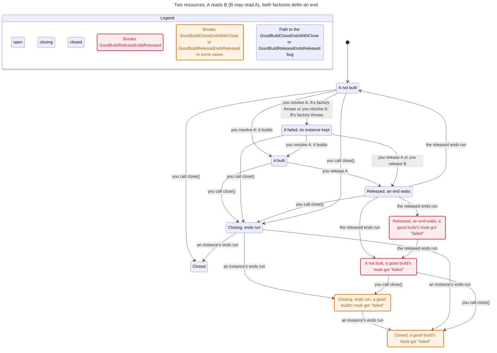
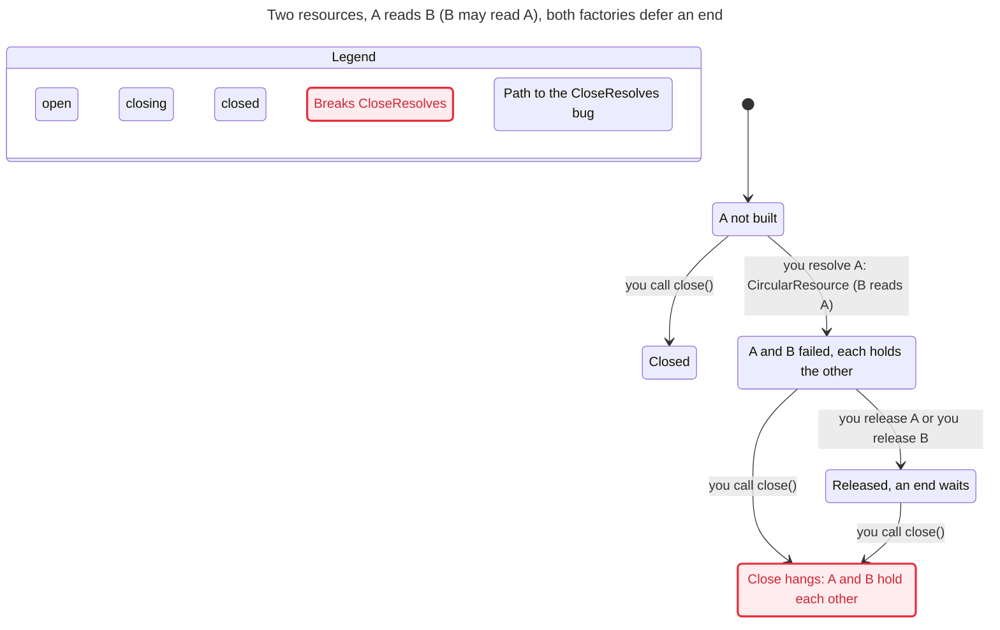

# resource-life

A resource instance is released like an unlinked file
([ADR 0063](../../decisions/0063-a-resource-instance-is-released-like-an-unlinked-file.md)).
Its ends run last first
([ADR 0026](../../decisions/0026-teardown-is-reverse-registration-lifo.md)).
Close is total
([ADR 0011](../../decisions/0011-close-is-structured-and-total.md))
and always resolves
([ADR 0027](../../decisions/0027-close-returns-a-result-and-never-throws.md)).

The spec: two resources at one scope. A reads B.
Both factories take `ctx`.
Each factory that runs defers one end,
then returns a value or throws.

It describes commit `c9c8817`,
the resource life in `packages/core/src/index.ts`
(its lines match `3ff6778`):
`instanceOf` 3666, `holdDependency` 3709,
`unlinkInstance` 3716, `finishInstance` 3777,
`settleResourceInstance` 3824, `buildResource` 3903,
`closeInstancesSync` 4689,
`invalidateResource` 5570, `drainReleased` 5830.

Two configs:

- `ResourceLife.cfg` — B reads nothing.
  `chart.mmd` draws it.
- `cycle.cfg` — B reads A, a cycle.
  `chart-cycle.mmd` draws it.

Words:

- **instance** — one lifetime record
  (`ResourceInstance`). A build after a failed one
  reuses it. Each build's ends run with that build's end.
- **end** — the status a deferred end gets:
  `released`, `failed`, or the close's status.
- **hold** — a dependent's instance holds
  its dependency's instance until it finishes.

## Rules

TLC reached 180 states (`ResourceLife.cfg`)
and 18 states (`cycle.cfg`).
The spec, the charts and the rerun
still describe `c9c8817`,
before the bug 6 and bug 7 fixes.
So they still show 3 rules break.

- **GoodBuildReleaseEndsReleased** — holds, since `b9bec7b5`
  (card `core/resource-failed-stays`).
  ADR 0063 d3, ADR 0026 Q4.
  A release fixes the end to `released`.
  A build the release picks ends `released`.
- **GoodBuildCloseEndsWithClose** — holds, since `b9bec7b5`
  (card `core/resource-failed-stays`).
  ADR 0063 d6.
  Close unlinks every instance
  with the close's end.
- **CloseResolves** — holds, since `e9242ca7`
  (card `core/resource-cycle-holds-close`).
  ADR 0027 (close always resolves),
  ADR 0011 (close is total).
- **HookRunsOnce** — holds. ADR 0026 Q4.
- **HooksRunLastFirst** — holds.
  ADR 0026 Q1, ADR 0063 d4.
  The spec copies the code's order,
  so this check cannot fail.
- **DependentFinishesFirst** — holds. ADR 0063 d4.
- **NoHookOnEndedInstance** — holds. ADR 0063 d3.
  The resolve after a release builds
  a new instance.
- **CloseRunsEveryHook** — holds. ADR 0011.
  In `cycle.cfg` it holds only
  because the close never ends.
- **NoDeadlock** — holds. From the tool.

## Chart: B reads nothing



- s7 and s8 break GoodBuildReleaseEndsReleased.
- s6 and s9 may break GoodBuildCloseEndsWithClose
  (or the release rule, on paths through s7).

## Chart: B reads A



- s4 breaks CloseResolves.

The charts hide `Done`: a step that changes nothing,
true only in the end states.

## Bug 6: a good build ends `failed`

Card `core/resource-failed-stays` fixes it
(`b9bec7b5`).
Rules: GoodBuildReleaseEndsReleased,
GoodBuildCloseEndsWithClose.

A failed sync build left `failed` on the instance.
The next good build reused that instance.
Its release (and its close) ended as `failed`.

The fix: when a build fails,
Core gives that build's ends the end `failed`
at once (`keepFailedEnds`).
It wraps only that build's ends,
so an earlier failed build's ends keep their own.
The instance keeps no `failed` mark.
So a later good build's ends get the release's
or the close's end.
The failed build's ends still get `failed`
(ADR 0026 Q4).
The paths below name the code before the fix.

### Path 1: a release

1. You resolve A. B builds.
   A's factory defers end `a1`, then throws.
   A's instance keeps `failed` (`:3830`)
   and stays on the node.
2. You resolve A. It reuses the instance (`:3671`).
   The factory defers `a2` and returns a value.
   `failed` stays.
3. You release A.
   `unlinkInstance` sets the end to
   `owned.failed ?? end` (`:3718`).
4. The ends run: `a2:failed`, `a1:failed`.
   ADR 0063 d3 wants `a2:released`.
   Since the fix: `a2:released`, `a1:failed`.

### Path 2: a close

1. As path 1, step 1.
2. As path 1, step 2.
3. You call `close()`.
   The close's status is `cancelled`.
4. The ends run: `a2:failed`, `a1:failed`,
   `b:cancelled`.
   ADR 0063 d6 wants `a2:cancelled`.
   Since the fix: `a2:cancelled`, `a1:failed`,
   `b:cancelled`.

## Bug 7: a cycle keeps `close()` open

Card `core/resource-cycle-holds-close` fixes it
(`e9242ca7`).
Rule: CloseResolves.

A reads B, B reads A, both take `ctx`.
CircularResource was raised,
but each instance held the other.
So `close()` never resolved.

The fix: `needsHold` is false
for a busy resource.
A busy resource is in its own sync build,
so a read of it raises CircularResource.
So B's build makes no hold on A.
Only A holds B, and the close resolves.
The path below names the code before the fix.

### Path 3: a cycle, then a close

1. You resolve A. A's instance holds B's.
2. B's build reads A.
   A holds B, so `needsHold(A)` is true.
   So B's instance holds A's
   (`:3710` refuses only a self-hold).
3. `CircularResource` throws.
   Both instances keep their holds.
4. You call `close()`.
   Each instance is held,
   so `unlinkInstance` adds a promise
   that never settles (`:3720`).
5. The close waits on it.
   The path test sees it still open after 500 ms.

The spec also shows:
a release of A or B in the cycle
leaves its end waiting forever (s3).
ADR 0063 d4 allows that:
a held instance waits for its holder.
Since the fix, A holds B, B holds nothing.
So only a release of B waits, for A.
Since `336a2885` that release
reaches A too: A keeps its edge to B.
A close after it resolves.

## Path tests

- `resource-life-paths.test.ts` — paths 1 and 2,
  now in `packages/core/tests/statechart/`.
  They pass since `b9bec7b5`.
  They failed before: that showed bug 6.
- Path 1 also checks the case with no rule yet:
  `expect(ended).toEqual([])` after step 1.
  It passes, before and after the fix.
- `instance-release.test.ts` pins both ends
  of path 1: `2:released`, `1:failed`.
- Path 3 is in `resource-life-paths.test.ts` now.
  It passes since `e9242ca7`.
  It failed before: that showed bug 7.
  The `paths/` folder is gone.

Run:

```sh
cd packages/core
vp test \
  tests/statechart/resource-life-paths.test.ts
```

## No rule yet

One case where no ADR names a rule.
Duke picks a rule
(card `core/states-rules-undecided`).
The other two cases are in
[round](../round/README.md#no-rule-yet).

### 3. A failed sync build's end waits

ADR 0026 Q4 says a build rejection ends `failed`.
No ADR says when its ends run.

What the code does today:
in path 1, `a1` does not run when the build throws.
It runs only at the release or the close.

1. You resolve A.
   A's factory defers `a1`, then throws.
2. No end has run.
3. You release A, or you call `close()`.
4. Now `a1` runs.

## What the spec leaves out

- Async builds: the `gen` guard,
  a late value (ADR 0063 d5), sticky async `failed`.
- Borrows by runs and the borrow gate
  (ADR 0026 Q2).
  The gate order slip (`gate ?? prev`, `:5813`)
  is not checked.
- Named buckets (`releaseNs`) and sessions.
- An end that is async or throws.
- The order of ends across instances at close
  (one step finishes one instance).
- A factory that takes no `ctx`.
  Every build here has an instance.
  A cycle without `ctx` is not checked.
- A factory that defers no end.
  Each factory that runs defers one.
- Only A is resolved by the app.
  B builds inside A's resolve.
- Close waits for pending work
  before it unlinks the instances
  (`startClose`).
  A release of B after A's build failed
  left B waiting for A.
  So that close never resolved,
  with or without a cycle.
  The spec's close unlinks every instance
  at once, so it misses this.
  Fixed in `336a2885`
  (card `core/failed-holder-blocks-close`):
  a failed A keeps its edge to B,
  so a release of B ends A first, then B.
  `instance-release.test.ts` pins both.
- At most 2 resolves and 1 release.

## Rerun

```sh
cd docs/states/resource-life
statechart ResourceLife.tla \
  --config ResourceLife.cfg \
  --view view.ts --out "$(mktemp -d)"
statechart ResourceLife.tla \
  --config cycle.cfg \
  --view view.ts --out "$(mktemp -d)"
```

Exit 1 today, for both:
2 rules break in `ResourceLife.cfg`,
1 in `cycle.cfg`.
The spec still describes `c9c8817`,
so it does not see the bug 6 and bug 7 fixes.
