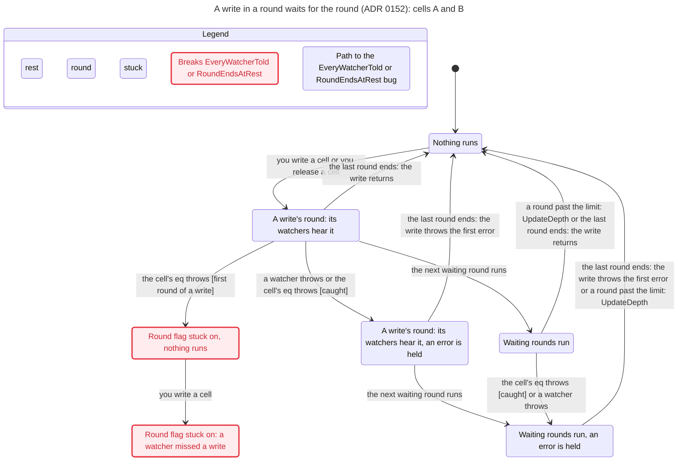

# round

A write in a round waits for the round
([ADR 0152](../../decisions/0152-a-write-in-a-round-waits-for-the-round.md)).
A build a reader starts must not write a cell
([ADR 0157](../../decisions/0157-a-resource-with-config-is-keyed.md)
d7).

The spec: one scope, cells A and B.
Watchers a1 and a2 hear A; b1 hears B.
a1 may write B; b1 may write A, so a chain grows.
Any watcher may throw. The cell's eq may throw.
`LIMIT = 1` stands for the code's 100.
The app makes at most 2 calls.

It describes commit `c9c8817`,
the round in `packages/core/src/index.ts`
(its lines match `3ff6778`).

## Rules

TLC reached 496 states.
The spec, the chart and the rerun
still describe `c9c8817`, before the fix.
So they still show 2 rules break.

- **RoundEndsAtRest** — holds after card
  `core/round-stuck-after-eq-throw`.
  ADR 0152 d3 (and d1).
  A round that waits runs after the rounds before it.
  So when no call runs, no round waits,
  and the round flag is off.
- **EveryWatcherTold** — holds after card
  `core/round-stuck-after-eq-throw`.
  ADR 0152 d1, d3.
  Each watcher hears each write, in order.
  Excused, as the ADR allows:
  - the later watchers of a round where one threw (d8);
  - the watchers of rounds that UpdateDepth cut (d6);
  - the watchers of a round whose own eq threw.
- **NoRoundPastLimit** — holds. ADR 0152 d5, d6.
- **DepthRaises** — holds. ADR 0152 d6.
  Past the limit, the first write gets UpdateDepth.
- **FirstErrorToFirstWrite** — holds. ADR 0152 d8.
  Checked only where d6 does not also apply
  (see "No rule yet").
- **NoWriteInRead** — holds. ADR 0157 d7
  (was ADR 0152 d7).
  The spec copies the code's check,
  so this check cannot fail;
  `rounds.test.ts` pins it.
- **NoDeadlock** — holds. From the tool.

## Chart



- s2 breaks RoundEndsAtRest.
- s4 breaks RoundEndsAtRest and EveryWatcherTold.

The chart hides `Done`: a step that changes nothing,
true only in the end states.
Steps inside one chart state are not drawn,
such as "a watcher hears the write".

## The bug (bug 5)

Card `core/round-stuck-after-eq-throw` fixes it.
When a cell is made, Core wraps its own eq once,
for the telling only.
In the telling, a throw from that eq
goes to `watcherThrew`.
That ends the round and turns the flag off.
The default `Object.is` cannot throw,
so it is not wrapped.
The write's own compare, before its round,
still calls the eq as it is.
The lines below name the code before the fix.

`tellWrite` sets `inRound = true`
with no `finally` (`index.ts:8845-8849`).
The eq calls in `flushOne` (`:1902`)
and `pendingNsWatchers` (`:1991`)
sit outside every catch.
A throw there leaves the flag on.

Then each later write only queues (`:8843`).
The flag is a module global,
so this hits every scope in the process.

The cold path (a release, `tell`, `:8877`)
catches the same throw.
The spec shows that path holds.

### Path

1. You write cell A. Its first round starts.
2. The cell's eq throws in that first round.
   The write throws. The round flag stays on.
3. You write cell B, in another scope.
   The value lands.
   B's watcher never hears it.

The path test sets it up this way:

- Cell A's eq is `(x, y) => x.id === y?.id`.
- A namespaced watcher of A last heard `null`.
- So the write calls `eq(null, null)`
  in the telling, and it throws.
- Before the bug, B's watcher hears `1`.

## Path tests

- `round-stuck.test.ts` — now in
  `packages/core/tests/statechart/`.
  It passes after the card.
  It failed before: that showed the bug.
- `round-eq-throw.test.ts`, next to it,
  holds 4 more cases:
  - an eq throw in a namespaced write
    (it failed before the fix too);
  - an eq throw in a waiting round;
  - an eq throw in a watcher's write,
    before that write's round;
  - a watcher catches that throw:
    its round goes on, in order.
- `paths/round-no-rule-yet.test.ts.txt` — today
  both tests pass. They pin what the code does
  for the 2 cases with no rule yet.
  It waits for Duke's rule
  (card `core/states-rules-undecided`).

Run:

```sh
cd packages/core
vp test tests/statechart/
```

## No rule yet

Two cases where no ADR names a winner.
Duke picks a rule
(card `core/states-rules-undecided`).
The third case is in
[resource-life](../resource-life/README.md#no-rule-yet).

### 1. UpdateDepth drops a watcher's error

ADR 0152 d6 says the first write raises UpdateDepth.
d8 says the first error goes to the first write.
When a watcher throws and then the chain
passes the limit, both cannot hold.

What the code does today:
`tooDeep` throws before `failed`
(`index.ts:8898`, `:8912`).
So the watcher's error is lost.

1. You write the cell.
2. Watcher 1 writes the cell again.
3. Watcher 2 throws.
4. The rounds run to depth 101.
5. The write throws UpdateDepth.
   The watcher's error is gone.

Test: `round-no-rule-yet.test.ts.txt`,
the first test. It passes today.

### 2. An equal write in a reader's build

ADR 0157 d7: a build a reader starts
"must not write a cell".

What the code does today:
it drops an equal write before the check
(`index.ts:1929` before `:1931`).
So an equal `set` in that build is silent:
no WriteInRead.

Duke decides if an equal `set` is a write.

Test: `round-no-rule-yet.test.ts.txt`,
the second test. It passes today.

## What the spec leaves out

- Layers and sessions: one scope.
  `flushCell` walks child layers;
  a throw in a parent skips the children too.
- Namespaced watchers as their own kind.
  The spec folds them into
  "the cell's eq" and "a watcher".
- Keyed resources woken by a change.
  A woken build may write (ADR 0157 d7);
  a1 and b1 stand for it.
- Write hooks (ADR 0050) and `update`.
- Async watchers and async loops.
  ADR 0152 does not cover them.
- The labels in UpdateDepth (the last 8 cells).
- Equal writes: every write flips the value.
- A release from inside a watcher.
- The eq call in `writeCell` before the round:
  a throw there only fails that write.

## Rerun

```sh
cd docs/states/round
statechart Round.tla \
  --config Round.cfg \
  --view view.ts --out "$(mktemp -d)"
```

Exit 1: 2 rules break.
The spec still describes `c9c8817`,
so it does not see the fix.
