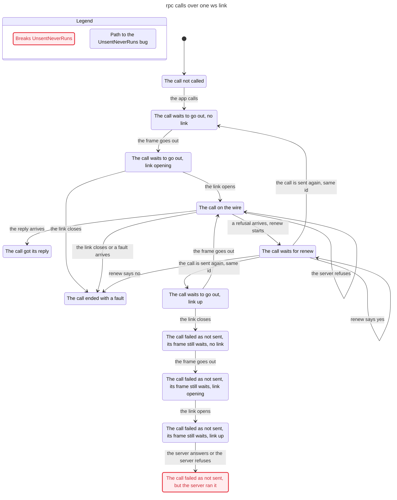
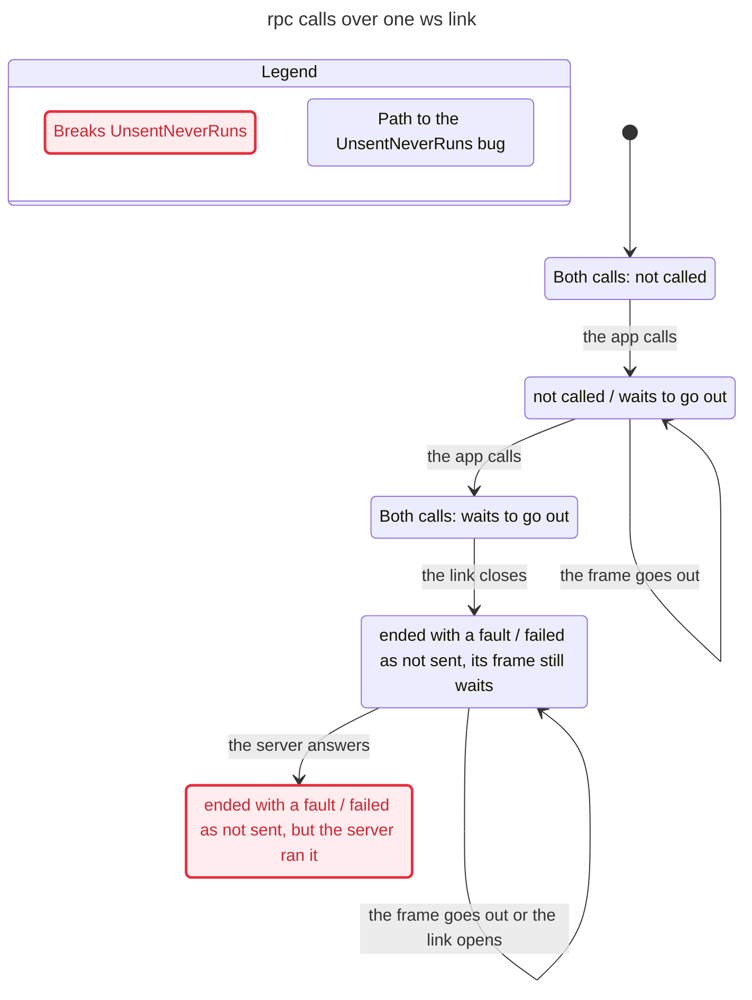

# rpc-call

rpc calls over one ws link:
[ADR 0147](../../decisions/0147-the-execution-id-a-call-ends-at-its-reply.md)
(the execution id, a call ends at its reply),
[ADR 0154](../../decisions/0154-core-keeps-the-meaning-the-backend-keeps-the-bytes.md)
and [ADR 0141](../../decisions/0141-a-fault-says-who-spoke.md).

The spec: two calls, one ws link
that closes at most once.
It describes commit `3ff6778` (release 0.28.0):
`packages/core` rpc and the ws client
in `packages/bun/src/client.ts`.

Two configs:

- `RpcCall.cfg` — 2 calls.
  `chart.mmd` draws only the bug path.
- `RpcCall-one.cfg` — 1 call.
  `chart-one.mmd` draws the whole life of one call.
  It finds the same bug, through a resend.

## Rules

TLC reached 1,737 states (2 calls).

- **ResendKeepsId** — holds. ADR 0147 d1.
  A resend after renew keeps the same execution id.
- **ServerBindsId** — holds. ADR 0147 d2.
  The server binds the caller's id.
- **EndsOnce** — holds. ADR 0147 d3.
  A call ends at its reply, once.
  A value end is a reply the server made.
- **FaultHasId** — holds. ADR 0147 d5.
  A fault carries the execution id.
- **RenewOnlyOnRefusal** — holds.
  ADR 0154 d2, the `RenewOp` doc, commit `14402c8`.
  Renew runs only on a refusal, one at a time.
- **UnsentNeverRuns** — holds, since `730d7e26`
  (bug 4, card `bun/client-drop-keeps-frames`).
  ADR 0141 (kept by ADR 0154).
  `link, sent: false` means nothing left,
  so nothing ran.
- **NoCallWaitsForever** — holds.
  ADR 0147 d3, and the ws client doc
  "every call ... fails as a link fault".
  Every call ends (with weak fairness).
- **NoDeadlock** — holds. From the tool.

A close mid call is `link, sent: true`, with no renew
(commit `14402c8`).

The charts and the TLC rerun still show the spec of commit `3ff6778`.
UnsentNeverRuns still breaks there. The code does not.

## Chart: one call



## Chart: two calls, the bug path



The charts hide `Done`: a step that changes nothing,
true only in the end states.

## The bug (bug 4)

Card `bun/client-drop-keeps-frames`.

`drop()` in `packages/bun/src/client.ts`
fails every waiter, but it does not empty `out`.
Then the `nextTick` in `post` sends what is left.
So a call failed as `link, sent: false`
still goes out, and the server runs it.

ADR 0141 says `sent: false`
"is the one case that is safe to send again".
So an app that sends it again on `sent: false`
runs it twice on the server.

### Path: two calls

1. The app makes call A.
2. The frame goes out. The client opens a socket.
3. The app makes call B.
   B's message waits in the frame buffer
   for the next tick.
4. The link closes before that tick.
   `drop` fails A and B as `link, sent: false`.
   B's message stays in the buffer.
5. The frame goes out.
   The tick finds no socket and opens a new one.
6. The link opens.
7. The server runs call B, with B's execution id.
   The client already told the app
   that B was not sent.

With one call, the same bug comes
through a resend:
refused, renew says yes, the resend waits,
and the link closes before the tick.

## Path test

The test lives in `packages/bun/tests/statechart-rpc-call.test.ts`.
It moved there from `paths/` in `f3a03adf`.

- Before the fix: 1 of 1 failed. A fail showed the bug.
- After the fix in `730d7e26`: 1 of 1 passes.
- It uses the real ws client and the real Bun ws server.
- It wraps `setImmediate` before the client loads,
  so it can hold the tick.
- It wraps `WebSocket`, so it can list the sockets
  and fire the first socket's `close` in that window.
- The fix is in `drop()` in `src/client.ts`.
  The test did not change then.
- Card `bun/client-empty-tick`, fix `a1b598ee`:
  a tick with an empty batch opens no socket.
  So step 5 opens no socket now.
  The test expects 1 socket, not 2.

Run it:

```sh
cd packages/bun
bun --bun vp test \
  tests/statechart-rpc-call.test.ts
```

## What the spec leaves out

- Only ws calls.
  Left out: the memory backend, watches and streams,
  meta, codec faults, byte uploads (POST), `reset()`,
  the caller's own abort, 404 `missing`,
  a renew that throws.
- A refusal from a client-side hook.
  It makes a fault before any execution id exists,
  so it is not a call's fault here.
- The link closes at most once.
  Server outcomes: value, refused, failed.
- A message that already left when the link closes
  is "stray": the server may still run it,
  and its reply is lost.
  That is why `sent: true` means "unknown".

## Rerun

```sh
cd docs/states/rpc-call
statechart RpcCall.tla \
  --config RpcCall.cfg \
  --view view.ts --out "$(mktemp -d)"
statechart RpcCall.tla \
  --config RpcCall-one.cfg \
  --view view.ts --out "$(mktemp -d)"
```

Exit 1 for both: the spec still shows commit `3ff6778`,
where 1 rule breaks.
