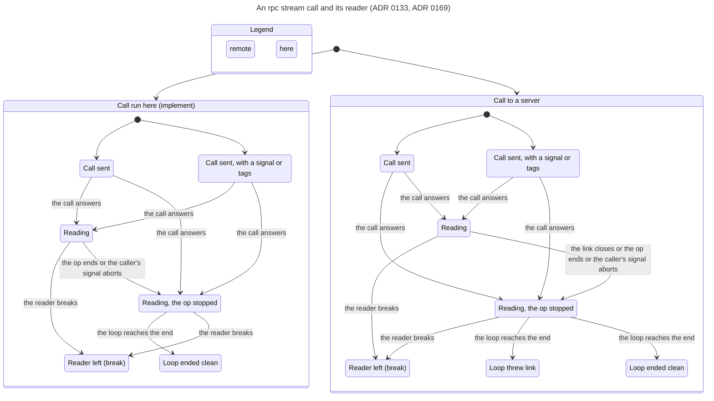

# rpc-stream

One rpc stream call and its reader.

- A call stopped by its own signal is cancelled
  for its caller
  ([ADR 0133](../../decisions/0133-a-call-stopped-by-its-own-signal-is-cancelled-for-its-caller.md)).
- `failed` means a throw, a bug
  ([ADR 0154](../../decisions/0154-core-keeps-the-meaning-the-backend-keeps-the-bytes.md)
  d2,
  [ADR 0141](../../decisions/0141-a-fault-says-who-spoke.md)).
- A stream call keeps its signal and tags
  for its stream: the fetch rule
  ([ADR 0169](../../decisions/0169-a-stream-call-keeps-its-signal-and-tags-for-its-stream.md)).

The spec: one stream call,
to a server (memory) or run here (`implement`),
with or without a caller's `signal`,
with or without `tags`.
The op sends 1 value.
Steps: the call answers, values come,
the op ends, the reader breaks,
the signal aborts, the link closes.

The constant `Fetch` picks the code:

- `RpcStream.cfg`: `Fetch = TRUE`,
  the code since ADR 0169.
- `RpcStream-before.cfg`: `Fetch = FALSE`,
  the code before (main `74211a57`).

The lines it models:

- `packages/core/src/rpc.ts`:
  `pull`, `leaving`, `sendKey`, `runHere`.
- `packages/core/src/index.ts`:
  `runHookCall`.
- `packages/core/src/rpc-protocol.ts`:
  `watchOver`, `bug`.
- `packages/core/src/memory.ts`: `open`.

## Rules

With `RpcStream.cfg`, TLC reached 394 states.
0 rules break.

- **OwnStopIsNotFailed** — holds,
  since `b0b86a5e` and `62b3364f`
  (card `core/own-signal-stream-failed`).
  ADR 0133 d1; ADR 0154 d2 and ADR 0141.
- **CallerSignalEndsStream** — holds.
  ADR 0133 d4.
- **BreakEndsStream** — holds.
  ADR 0133 d4 and its proof.
- **LinkCloseIsLink** — holds.
  ADR 0141 table, ADR 0154 d2.
- **AnswersAtOnce** — holds.
  ADR 0169 d1: the call answers at once.
- **AnswerKeepsStream** — holds.
  ADR 0169 d1: the answer never stops
  the stream.
- **SignalEndsClean** — holds.
  ADR 0169 d2: the signal ends the loop clean.
- **NoDeadlock** — holds. From the tool.

With `RpcStream-before.cfg`, TLC reached
411 states. 3 rules break.
Card `core/stream-call-session` fixed all 3.

## Chart



The chart hides `Done`: a step that changes nothing,
true only in the end states.

## Before ADR 0169: a signal or tags cut the stream

Card `core/stream-call-session`.
It also closes card `core/local-stream-signal`.

A call with a `signal` or `tags`
ran in its own child session (ADR 0090).
That session ended when its body returned,
as a transaction callback does.
A stream call returns its reader at once.

### Path 1: AnswersAtOnce

1. You call a stream run here with tags.
   The op runs.
   The call cannot answer:
   its session waits for the op to end.

### Path 2: AnswerKeepsStream

1. You call a remote stream with a signal.
2. The call answers.
   Its session ends and stops the watch.
   The reader gets only what came before.

### Path 3: SignalEndsClean

1. You call a stream run here with a signal.
   The call waits.
2. The caller's signal aborts.
3. The call answers.
4. The loop reaches the end.
   It throws Core's `AbortError`.

The fix (ADR 0169):

- A stream key's call opens no child session
  (`runHookCall` in `index.ts`).
- The caller's signal aborts the stream's leave,
  as a break does (`leaving` in `rpc.ts`).
- The call's tags bind the stream's own run.

## Path tests

- `packages/core/tests/statechart/rpc-stream-paths.test.ts`:
  - path 1 of bug 14 (OwnStopIsNotFailed);
  - a stream run here with a signal
    answers at once, and the signal ends it
    clean (paths 1 and 3);
  - an aborted signal runs nothing (ADR 0169 d4);
  - a stream run here with tags answers at once,
    and its op reads the tags (ADR 0169 d3);
  - a stream call's tags reach its lifecycle
    hooks, here and remote (ADR 0169 d3).
- `packages/core/tests/kit/backend.ts`,
  on memory and on ws (path 2):
  - a stream with a signal reads until
    the signal aborts;
  - a stream with tags reads until
    the reader leaves;
  - an aborted signal reads nothing,
    and the server runs nothing.

Each one fails before the fix.

Run:

```sh
cd packages/core
vp test tests/statechart/rpc-stream-paths.test.ts
```

## What the spec leaves out

- `stop()` from outside the loop
  (the same end as a break).
- A fault from the server (refused, invalid),
  and a throw in the op.
- Two loops on one reader (the one-waiter `wake`).
- A signal that aborted before the call
  (ADR 0169 d4; tested, not modelled).
- More than 1 value.

## Rerun

```sh
cd docs/states/rpc-stream
statechart RpcStream.tla \
  --config RpcStream.cfg \
  --view view.ts --out "$(mktemp -d)"
```

Exit 0: every rule holds.
With `--config RpcStream-before.cfg`:
exit 1, 3 rules break.
