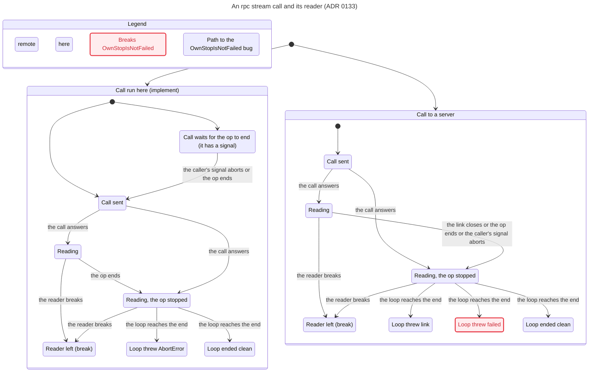

# rpc-stream

A call stopped by its own signal is cancelled
for its caller
([ADR 0133](../../decisions/0133-a-call-stopped-by-its-own-signal-is-cancelled-for-its-caller.md)).
`failed` means a throw, a bug
([ADR 0154](../../decisions/0154-core-keeps-the-meaning-the-backend-keeps-the-bytes.md)
d2,
[ADR 0141](../../decisions/0141-a-fault-says-who-spoke.md)).

The spec: one stream call,
to a server (memory) or run here (`implement`),
with or without a caller's `signal`.
The op sends 1 value.
Steps: the call answers, values come,
the op ends, the reader breaks,
the signal aborts, the link closes.

It describes commit `c9c8817`
(its lines match `3ff6778`):

- `packages/core/src/rpc.ts`: `pull` 220,
  the remote path 363-390, `runHere` 406-450.
- `packages/core/src/rpc-protocol.ts`:
  `watchOver` 159, `bug` 196.
- `packages/core/src/memory.ts`: `open` 251.

## Rules

TLC reached 188 states.
The spec, the chart and the rerun
still describe `c9c8817`,
before the bug 14 fix.
So they still show 1 rule breaks.

- **OwnStopIsNotFailed** — holds,
  since `b0b86a5e` and `62b3364f`
  (card `core/own-signal-stream-failed`).
  ADR 0133 d1 (a call stopped by its own signal
  is a cancellation);
  ADR 0154 d2 and ADR 0141
  (`failed` means a throw, a bug).
- **CallerSignalEndsStream** — holds. ADR 0133 d4.
- **BreakEndsStream** — holds.
  ADR 0133 d4 and its proof.
- **LinkCloseIsLink** — holds.
  ADR 0141 table, ADR 0154 d2.
- **NoDeadlock** — holds. From the tool.

## Chart



- s14 breaks OwnStopIsNotFailed.

The chart hides `Done`: a step that changes nothing,
true only in the end states.

## Bug 14: your own signal ends a stream as `failed`

Card `core/own-signal-stream-failed`.
Rule: OwnStopIsNotFailed.

The signal closes the call's child session.
The watch run throws there.
`watchOver`'s `bug` (`rpc-protocol.ts:196`)
checks the watch's own leave signal,
which is not aborted.
So it logs a bug and says `failed`.

The memory test "a caller's signal ends the stream"
caught any rpc fault, so it did not see this.

Fixed in `b0b86a5e` and `62b3364f`.
Two places took the stop as a bug,
and each one alone said `failed`:

- `watchOver` in `rpc-protocol.ts`
  (it pushed `failed`);
- the watch's catch in `rpc.ts`
  (it threw `failed`).

Now each one checks whose stop it was,
not the error's name:

- The memory and ws clients give `watchOver`
  the watch's own session signal.
  A leave and the call's own stop both abort it.
  So `bug` sees the stop and pushes nothing.
- The catch in `rpc.ts` checks
  the call's own session signal.
  Once it aborted, the stream ends clean.

Any other throw still logs a bug and says `failed`.
That holds for an `AbortError` the caller did not cause,
such as a meta op whose own fetch stopped.
The memory test now rejects a `failed` fault.

### Path 1: a remote call with a signal

1. You call a remote stream with a signal.
   The call answers.
2. The caller's signal aborts.
3. The loop reaches the end.
   It throws `failed`.
   ADR 0133 d1 wants a cancellation.

## Path tests

- The OwnStopIsNotFailed test (path 1)
  lives in
  `packages/core/tests/statechart/rpc-stream-paths.test.ts`.
  Card `core/own-signal-stream-failed`
  moved it there and cut it from the `.txt`.
  It passes since `b0b86a5e`.
- `paths/rpc-stream-paths.test.ts.txt`
  now holds only the second test.
  It passes.
  It pins card `core/local-stream-signal`
  (see [No rule yet](#no-rule-yet)).
  That card changes it to its fix,
  then moves it in.

Run:

```sh
cd packages/core
vp test tests/statechart/rpc-stream-paths.test.ts
```

## No rule yet

### A stream run here with a signal waits

Card `core/local-stream-signal` (on the board).
A stream key run here, called with a `signal`,
does not answer until its op ends.
ADR 0090 runs the call in a child session;
that session answers when its work ends.
ADR 0133 lists the card under "Not done here",
with no rule.

What the code does today
(chart: "Call waits for the op to end"):

1. You call with a signal.
   After 300 ms it still waits.
2. The signal aborts. The call answers.
3. The loop reads the value.
   Then it throws Core's `AbortError`
   ("The scope closed before this work finished"),
   not the signal's reason.

Test: `rpc-stream-paths.test.ts.txt`,
its one test. It passes today.

## What the spec leaves out

- `stop()` from outside the loop
  (the same end as a break).
- A fault from the server (refused, invalid),
  and a throw in the op.
- Two loops on one reader (the one-waiter `wake`).
- The abort listener `runHere` leaves
  on the caller's signal (`rpc.ts:434`):
  a heap leak, not a state.
- More than 1 value.

## Rerun

```sh
cd docs/states/rpc-stream
statechart RpcStream.tla \
  --config RpcStream.cfg \
  --view view.ts --out "$(mktemp -d)"
```

Exit 1: 1 rule breaks.
The spec still describes `c9c8817`,
before the bug 14 fix.
