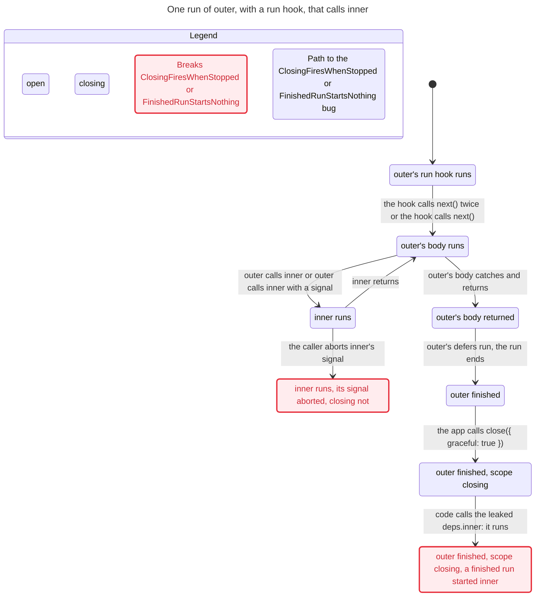

# run-life

A call signal owns and stops one action
([ADR 0090](../../decisions/0090-a-call-signal-owns-and-stops-one-action.md)).
Closing begins with a signal
([ADR 0104](../../decisions/0104-closing-begins-signal.md)).
A call stopped by its own signal is cancelled
for its caller
([ADR 0133](../../decisions/0133-a-call-stopped-by-its-own-signal-is-cancelled-for-its-caller.md)).
An error is a value, and settle recovers
([ADR 0067](../../decisions/0067-an-error-is-a-value-a-panic-is-stamped-at-its-origin-and-settle-recovers.md)).

The spec: a root L with one capsule run hook.
The app runs `outer`.
For `outer` the hook calls `next()`
once, twice, or not at all;
for any other op, once.
Each body of `outer` registers a defer,
keeps its `deps.inner` (a leak),
calls `inner` once, and catches what it throws.
`inner` is called plain, with its own signal
(child session K), or through `settle` with a signal.
`inner` ends in one of 5 ways:
it returns, a panic, a managed error,
its signal's reason, or an error that wraps it.
L closes gracefully.

It describes commit `c9c8817`,
the run life in `packages/core/src/index.ts`
(its lines match `3ff6778`):
`ensureRunning` 1795, `runFailure` 2664,
`OperationCtx.share` 2947, `runSessionWith` 4811,
`closeLayer` 4543, `failedRun` 5292,
`runHookBody` 7164, `finishHookDone` 7254.

## Rules

TLC reached 743 states,
more than the chart budget of 500.
So the chart draws only the bug paths.
The spec, the chart and the rerun
still describe `c9c8817`,
before the bug 10 fix.
So they still show 2 rules break.

- **ClosingFiresWhenStopped** — holds,
  since `d3ab993c`
  (card `core/own-signal-leaves-closing`).
  ADR 0104, with ADR 0090.
- **FinishedRunStartsNothing** — breaks,
  but the rule may not apply.
  ADR 0127 d2 (and its Context:
  "a closing scope refuses a new call"),
  with ADR 0028 d2.
  See [No rule yet](#no-rule-yet), case 6.
- **OwnSignalIsCancel** — holds. ADR 0133 d1.
- **OtherRejectionSticks** — holds.
  ADR 0133 d2, d3; ADR 0067
  (a panic sticks even if caught).
- **ManagedIsAValue** — holds.
  ADR 0067 As built (errors/t03).
- **SettleRecovers** — holds.
  ADR 0067 ("settle recovers"), ADR 0133 d1,
  ADR 0026 d5.
  It checks both copies of the own-signal test
  (`runFailure` `index.ts:2673`,
  `failedRun` `index.ts:5293`).
- **EachDeferOnceAtRunEnd** — holds. ADR 0024.
  With `next()` twice, both bodies' defers
  share one list, and each runs once.
- **NoNextNoBody** — holds. ADR 0050 d1.
- **IsNamesTheOp** — holds, but weak.
  ADR 0142 d1.
  The spec copies the code's `this.op === op`,
  so this check cannot fail.
  The tests pin it.
- **AbortedSignalStartsNoBody** — holds. ADR 0090.
- **NoDeadlock** — holds. From the tool.

## Chart



- s3 breaks ClosingFiresWhenStopped.
- s7 breaks FinishedRunStartsNothing.

The chart hides `Done`: a step that changes nothing,
true only in the end states.

## Bug 10: a call stopped by its own signal stays open

Card `core/own-signal-leaves-closing` fixes it
(`d3ab993c`).
Rule: ClosingFiresWhenStopped.
The text below names the code before the fix.

The fix: when the call signal aborts,
`runSessionWith` fires K's closing signal,
then aborts K's `ctx.signal`.
`closeLayer` fires it again later:
an abort that already fired does nothing.

A call signal aborts.
`runSessionWith` (`index.ts:4830`)
sets `K.closed` and aborts K's `ctx.signal`.
It does not fire K's closing signal.
That fires only in `closeLayer`,
after the body ends.

### Path 1: a stopped call hangs

1. Outer's run hook runs.
2. The hook calls `next()`: outer's body runs.
3. Outer calls inner with a signal.
   Inner runs in its child session K.
   It reads a session resource
   built as ADR 0104's example:
   it ends its waits from `ctx.closing`.
4. The caller aborts inner's signal.
   `ctx.signal` aborts. `ctx.closing` does not.
5. The resource's wait never ends.
   The call stays pending until the root closes.
   ADR 0090: "An abort stops that child
   and waits for its cleanup."

## Path tests

- `run-life-paths.test.ts` —
  ClosingFiresWhenStopped, path 1,
  now in `packages/core/tests/statechart/`.
  It passes since `d3ab993c`.
  It failed before: that showed bug 10.
- `paths/statechart-run-life.test.ts.txt` —
  FinishedRunStartsNothing and its control
  are left.
  FinishedRunStartsNothing fails today:
  the path in case 6 below.
  The control passes:
  with `next()` once,
  the finished run's `deps.inner` is refused.

Card `core/own-signal-leaves-closing`
moved the ClosingFiresWhenStopped test in:
it cut it from the `.txt`,
with the `http` resource only it used.
The FinishedRunStartsNothing test and the control
wait for Duke's rule
(card `core/states-rules-undecided`).

Run:

```sh
cd packages/core
vp test \
  tests/statechart/run-life-paths.test.ts
```

## No rule yet

One case where no ADR names a rule.
Duke picks a rule
(card `core/states-rules-undecided`).
Cases 4 and 5 are in
[session-life](../session-life/README.md#no-rule-yet).

### 6. A run hook calls `next()` twice

ADR 0050 d1 says only what skipping `next()` does.
ADR 0127 d2 says a call after a close
meets `Disposed`.
Its Context says "a closing scope
refuses a new call".
ADR 0028 d2 lets work in flight finish.
So ADR 0127 d2 may or may not cover
a scope that is still closing.

What the code does today:

1. Outer's run hook runs.
2. The hook calls `next()` twice.
   Both bodies run.
   Body 2's ctx replaces `run.ctx`
   (`index.ts:7178`).
   `OperationCtx.share` copies only the defer list.
3. The run returns body 2's value.
4. Outer's defers run; the run ends.
   `finishHookDone` (`index.ts:7256`)
   clears `live` on body 2's ctx only.
5. The app calls `close({ graceful: true })`.
6. Code calls body 1's leaked `deps.inner`.
   `ensureRunning` (`index.ts:1798`)
   trusts `caller.live`, so inner runs.

If ADR 0127 d2 covers a scope still closing,
this is a bug:
step 6 must meet `Disposed`.
The code's own intent agrees:
it clears `live` when a run ends.

Tests:

- `paths/statechart-run-life.test.ts.txt`,
  FinishedRunStartsNothing.
  It fails today: it asks for `Disposed`.
- [`statechart-no-rule.test.ts.txt`](../session-life/paths/statechart-no-rule.test.ts.txt),
  "no rule 3": both bodies run.
  It passes today.

A hook tool's ctx made before `next()`
is not a second way in:
every hook tool checks `run.live` first
(`withHookAccess`, `index.ts:7061`).

## What the spec leaves out

- A forced close of L.
  A forced close seals the scope at once,
  so no late call gets in.
- Sessions other than K, resources
  (only in the path test), borrows, spans,
  origins, and `event.input`.
- The hook tool's ctx path; a hook that fails;
  a second, different hook error
  (`failHookRun` writes over the first).
- Async hook work left unreturned (`run.work`).
- Defer errors and async defers.

## Rerun

```sh
cd docs/states/run-life
statechart RunLife.tla \
  --config RunLife.cfg \
  --view view.ts --out "$(mktemp -d)"
```

Exit 1 today: 2 rules break.
The spec still describes `c9c8817`,
so it does not see the bug 10 fix.
