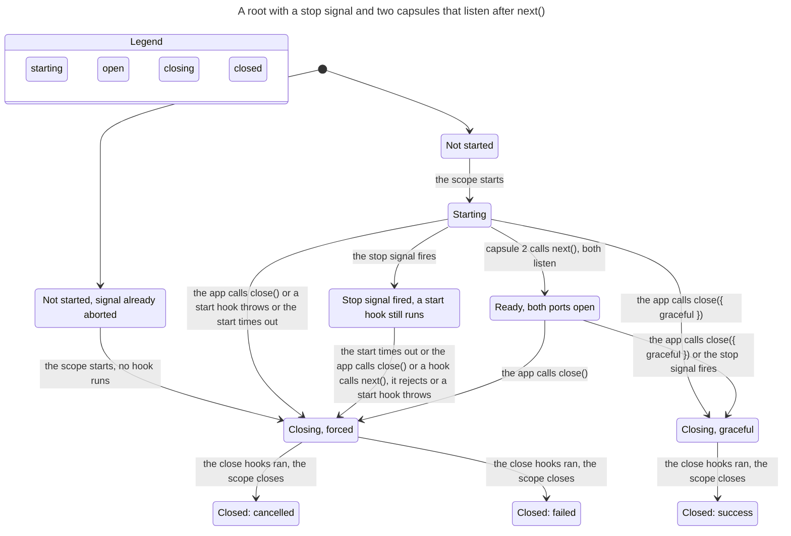

# scope-life

A stop during start ends the start
([ADR 0134](../../decisions/0134-a-stop-during-start-ends-the-start.md)).

The spec: a root with a stop signal
and two capsules that listen after `next()`.
It describes the root's start and close in `packages/core`,
with the ADR 0165 fix (`aa79955b`,
card `core/stop-signal-then-later-event`)
and its d2 amend (`45622e2b`,
card `core/closed-follows-first-cause`).

## Rules

The rules come from
[ADR 0165](../../decisions/0165-settled-is-the-twin-of-ready.md)
and the ADR 0134 rules it keeps.
TLC reached 127 states.
On main before the fix it reached 199,
and 5 rules broke.
Before the amend's fix it reached 131,
and 1 rule broke (ClosedFollowsFirstCause).

- **NoWorkAfterStop** — holds. ADR 0134 d1.
  After a stop, `next()` rejects,
  so no hook does work after its `next()`.
- **NoHookStartsAfterStop** — holds. ADR 0134 d1.
  A hook that has not started does not start.
- **SignalForcesClose** — holds (fix `aa79955b`). ADR 0134 d2.
  A stop signal during start forces the close,
  and the close hooks run.
- **SignalClosedCancelled** — holds (fix `aa79955b`). ADR 0134 d2.
  Then `closed` is `cancelled`.
- **FirstErrorWins** — holds. ADR 0134 d2,
  kept by ADR 0165 d2.
  A start error that comes first wins.
- **FirstCauseRejectsReady** — holds (fix `aa79955b`).
  ADR 0165 d2 (amends ADR 0134 d2),
  [ADR 0085](../../decisions/0085-a-root-owns-its-lifetime-a-stop-signal-closed-and-ready-after-cleanup.md)
  d4.
  The first event that ends the start is its cause:
  a stop signal, a start hook's throw,
  a start timeout, or a `close()`.
  `ready` rejects with that cause.
- **SettledNamesFirstCause** — holds (fix `aa79955b`). ADR 0165 d1, d2.
  `settled` names the same cause and never rejects.
  Its status is `success`, `cancelled`
  (a signal, a close) or `failed`
  (a start error, a timeout).
  Main has no `settled`:
  the spec reads it from `ready`, as the fix builds it.
- **LaterErrorDropped** — holds (fix `aa79955b`). ADR 0165 d2.
  A later error is dropped:
  only a first error or timeout fails the start.
- **ClosedFollowsFirstCause** — holds (fix `45622e2b`).
  ADR 0165 d2, amended
  (Duke, 2026-11-21 14:58 UTC).
  `closed` names the same first cause.
  A start error or a timeout first fails it.
  A stop signal or a close first never does:
  a later start error is dropped,
  and is not in `teardownErrors`.
  The close's mode picks `cancelled` (forced)
  or `success` (graceful), as ADR 0028 says.
- **PreAbortedRunsNoHook** — holds. ADR 0134 d3.
  A signal that is already aborted runs no hook.
- **ReadyRejectsAfterClose** — holds. ADR 0085 d4.
  `ready` rejects only after the forced close ends.
- **NoPortAfterClosed** — holds.
  ADR 0134 Context and Results.
  Once `closed` settles, no port stays open.
- **NoDeadlock** — holds. From the tool.

On main, each break needed the stop signal first (bug 3).
With each break rule guarded by "the signal did not come first",
the check of main exited 0.

## Chart

The chart after the fix.
Every event after the stop signal
leads to the forced close.
The chart of main, with bug 3 in red,
is in [ADR 0165](../../decisions/0165-settled-is-the-twin-of-ready.md).



The chart hides `Done`: a step that changes nothing,
true only in the end states.

## The bug (bug 3)

Fixed in `aa79955b`.
The rest of this part tells the bug on main.

All 5 breaks share one cause.
The stop signal fires during start.
Then a second event comes
before the running hooks return:

- a start hook throws;
- the start times out;
- or the app calls `close()`.

The code then reports that later event,
not the signal:

- `ready` rejects with the later event's reason.
- `closed` is `failed`
  (or `success` after a graceful close),
  not `cancelled`.
- After `close({ graceful: true })`,
  the close hooks see `graceful: true`.

ADR 0134 d2 names one exception only:
"a start error that comes first".
It does not name a later error, a timeout,
or a later close.

Duke picked (2026-11-21):
[ADR 0165](../../decisions/0165-settled-is-the-twin-of-ready.md)
amends ADR 0134 d2.
The first cause wins, in both orders.
So the signal wins here, and the code changes
(card `core/stop-signal-then-later-event`).

`run` (`packages/bun/src/run.ts`) still exits
with the signal's code (`code ||=` keeps the first).
But it logs the later error,
and ADR 0134 d4 says "logs nothing".

### Path 1: a start error after the signal

Breaks FirstCauseRejectsReady,
SettledNamesFirstCause, LaterErrorDropped
and SignalClosedCancelled.

1. The scope starts.
   Capsule 1 runs its work before `next()`.
2. The stop signal fires. Core waits for capsule 1.
3. Capsule 1 throws a start error.
4. Capsule 2's close hook runs.
5. Capsule 1's close hook runs.
6. The scope closes. `closed` is `failed`,
   and `ready` rejects with the start error,
   not the signal's reason.

### Path 2: a graceful close after the signal

Breaks SignalForcesClose, SignalClosedCancelled,
FirstCauseRejectsReady and SettledNamesFirstCause.

1. The scope starts.
   Capsule 1 runs its work before `next()`.
2. The stop signal fires.
3. The app calls `close({ graceful: true })`.
4. Capsule 2's close hook runs,
   with `graceful: true`.
5. Capsule 1's close hook runs,
   with `graceful: true`.
6. The scope closes. `closed` is `success`,
   and `ready` rejects with the closing reason
   (code 20).

### Path 3: the start times out after the signal

The chart state "failed, StartTimeout,
after the stop signal".
Breaks FirstCauseRejectsReady,
SettledNamesFirstCause, LaterErrorDropped
and SignalClosedCancelled.

1. The scope starts (`startTimeout: 50`).
2. The stop signal fires.
3. The start times out.
4. The close hooks run, and the scope closes.
   `ready` rejects with `StartTimeout`,
   and `closed` is `failed`.

## Path tests

The path test lives in Core's tests:
`packages/core/tests/statechart/scope-life-paths.test.ts`.
All 6 tests pass.

- Paths 1 to 3: the signal comes first,
  so `ready` rejects with the signal's reason,
  `settled` is `cancelled` with it,
  and `closed` is `cancelled`.
- A start error, then the signal:
  the error wins, and `settled` is `failed`.
- ClosedFollowsFirstCause:
  a `close()`, then a start error.
  `closed` and `settled` are `cancelled`,
  with no `teardownErrors`.
  Red on main before fix `45622e2b`.
- The control (the signal alone).

Run:

```sh
cd packages/core
vp test tests/statechart/scope-life-paths.test.ts
```

## What the spec leaves out

- A hook's work after `next()` is sync,
  as `serve`'s `Bun.serve` is.
  No `await` between `next()` and opening a port.
- A hook that drops `next()`
  (does not await or return it).
  ADR 0134 says a hook must not do that.
- An outer hook that catches a real start error
  from `next()` and returns.
  Then `ready` resolves. No ADR rule covers it.
- A `close()` during start does not wait
  for a start hook that still runs.
  ADR 0134's Precedent says it does.
  That line is not a decision,
  so it is a note, not a rule.
- `closeLayer`'s Result is taken as ADR 0028 says;
  the spec does not check it.
- Owned work, sessions, resources, `defer`,
  teardown errors, a close from inside a hook,
  `withData`, a close hook that skips `next()`,
  more than 2 capsules, and `run`'s exit code.

## Rerun

```sh
cd docs/states/scope-life
statechart ScopeLife.tla \
  --config ScopeLife.cfg \
  --view view.ts --out "$(mktemp -d)"
```

Exit 0 today: every rule holds.
