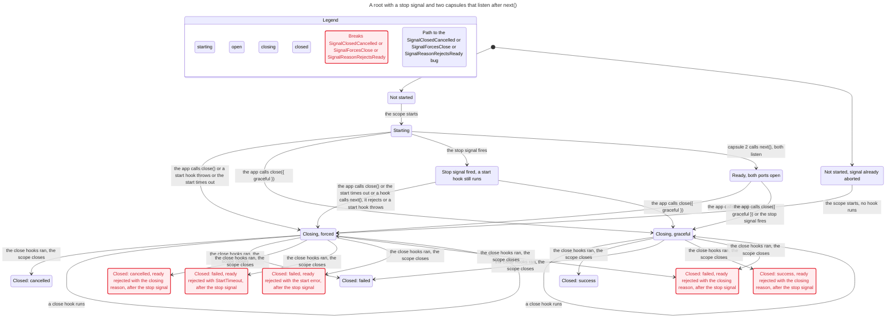

# scope-life

A stop during start ends the start
([ADR 0134](../../decisions/0134-a-stop-during-start-ends-the-start.md)).

The spec: a root with a stop signal
and two capsules that listen after `next()`.
It describes commit `3ff6778` (release 0.28.0),
the root's start and close in `packages/core`.

## Rules

TLC reached 199 states.

- **NoWorkAfterStop** — holds. ADR 0134 d1.
  After a stop, `next()` rejects,
  so no hook does work after its `next()`.
- **NoHookStartsAfterStop** — holds. ADR 0134 d1.
  A hook that has not started does not start.
- **SignalForcesClose** — breaks. ADR 0134 d2.
  A stop signal during start forces the close,
  and the close hooks run.
- **SignalReasonRejectsReady** — breaks.
  ADR 0134 d2,
  [ADR 0085](../../decisions/0085-a-root-owns-its-lifetime-a-stop-signal-closed-and-ready-after-cleanup.md)
  d4.
  Then `ready` rejects with the signal's reason.
- **SignalClosedCancelled** — breaks. ADR 0134 d2.
  Then `closed` is `cancelled`.
- **FirstErrorWins** — holds. ADR 0134 d2.
  A start error that comes first wins.
- **PreAbortedRunsNoHook** — holds. ADR 0134 d3.
  A signal that is already aborted runs no hook.
- **ReadyRejectsAfterClose** — holds. ADR 0085 d4.
  `ready` rejects only after the forced close ends.
- **NoPortAfterClosed** — holds.
  ADR 0134 Context and Results.
  Once `closed` settles, no port stays open.
- **NoDeadlock** — holds. From the tool.

## Chart



The chart hides `Done`: a step that changes nothing,
true only in the end states.

## The bug (bug 3)

All 3 breaks share one cause.
The stop signal fires during start.
Then a second event comes
before the running hooks return:

- a start hook throws;
- the start times out;
- or the app calls `close()`.

The code then reports that later event,
not the signal:

- `ready` rejects with the later event's reason.
- `closed` is `failed`
  (or `success` after a graceful close),
  not `cancelled`.
- After `close({ graceful: true })`,
  the close hooks see `graceful: true`.

ADR 0134 d2 names one exception only:
"a start error that comes first".
It does not name a later error, a timeout,
or a later close.

So Duke picks (card
`core/stop-signal-then-later-event`, Blocked):

- **Signal wins** — the code changes.
- **Later event wins** — ADR 0134 d2 changes.

`run` (`packages/bun/src/run.ts`) still exits
with the signal's code (`code ||=` keeps the first).
But it logs the later error,
and ADR 0134 d4 says "logs nothing".

### Path 1: a start error after the signal

Breaks SignalReasonRejectsReady
and SignalClosedCancelled.

1. The scope starts.
   Capsule 1 runs its work before `next()`.
2. The stop signal fires. Core waits for capsule 1.
3. Capsule 1 throws a start error.
4. Capsule 2's close hook runs.
5. Capsule 1's close hook runs.
6. The scope closes. `closed` is `failed`,
   and `ready` rejects with the start error,
   not the signal's reason.

### Path 2: a graceful close after the signal

Breaks SignalForcesClose.

1. The scope starts.
   Capsule 1 runs its work before `next()`.
2. The stop signal fires.
3. The app calls `close({ graceful: true })`.
4. Capsule 2's close hook runs,
   with `graceful: true`.
5. Capsule 1's close hook runs,
   with `graceful: true`.
6. The scope closes. `closed` is `success`,
   and `ready` rejects with the closing reason
   (code 20).

### Path 3: the start times out after the signal

The chart state "failed, StartTimeout,
after the stop signal".

1. The scope starts (`startTimeout: 50`).
2. The stop signal fires.
3. The start times out.
4. The close hooks run, and the scope closes.
   `ready` rejects with `StartTimeout`,
   and `closed` is `failed`.

## Path tests

`paths/statechart-scope-life.test.ts.txt`
goes to `packages/core/tests/`.

- Today: 3 fail (paths 1 to 3).
  A fail shows the bug.
- The control (the signal alone) passes.

Card `core/stop-signal-then-later-event` moves it,
without the `.txt`, once Duke picks.
If the ADR changes instead,
the 3 tests change to the new rule.

Once moved, run:

```sh
cd packages/core
vp test tests/statechart-scope-life.test.ts
```

## What the spec leaves out

- A hook's work after `next()` is sync,
  as `serve`'s `Bun.serve` is.
  No `await` between `next()` and opening a port.
- A hook that drops `next()`
  (does not await or return it).
  ADR 0134 says a hook must not do that.
- An outer hook that catches a real start error
  from `next()` and returns.
  Then `ready` resolves. No ADR rule covers it.
- A `close()` during start does not wait
  for a start hook that still runs.
  ADR 0134's Precedent says it does.
  That line is not a decision,
  so it is a note, not a rule.
- `closeLayer`'s Result is taken as ADR 0028 says;
  the spec does not check it.
- Owned work, sessions, resources, `defer`,
  teardown errors, a close from inside a hook,
  `withData`, a close hook that skips `next()`,
  more than 2 capsules, and `run`'s exit code.

## Rerun

```sh
cd docs/states/scope-life
statechart ScopeLife.tla \
  --config ScopeLife.cfg \
  --view view.ts --out "$(mktemp -d)"
```

Exit 1 today: 3 rules break.
