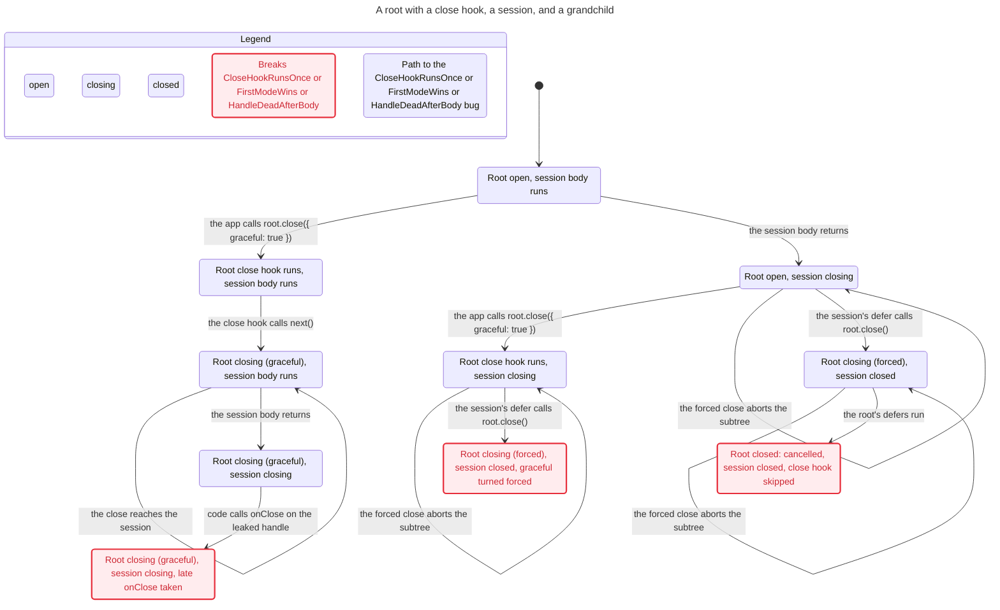

# session-life

A session's handle closes when its body ends
([ADR 0071](../../decisions/0071-a-sessions-handle-closes-when-its-body-ends-an-idle-session-ends-in-place.md)).
Closing begins with a signal, and a root's close hook
runs once
([ADR 0104](../../decisions/0104-closing-begins-signal.md)).
The first close's mode wins
([ADR 0029](../../decisions/0029-teardown-v1-accepted-limitations.md)
d1).
Close is total
([ADR 0011](../../decisions/0011-close-is-structured-and-total.md)).

The spec: a root R with one capsule close hook
and two defers (r1, then r2).
A child session S runs a body and registers one defer.
S's body may open a grandchild G and await it;
G registers one defer.
Fixed per run: S catches G's failure or not;
S's defer calls `root.close()` or not.

It describes commit `c9c8817`,
the layer life in `packages/core/src/index.ts`
(its lines match `3ff6778`):
`ensureOpen` 1778, `closeLayer` 4543,
`startClose` 4614, `runSessionWith` 4811,
`settleSessionWith` 4886, `watchRootClose` 6785,
`closeWouldReenter` 2800.

Words:

- **swept** — `Layer.swept`: an ancestor's close
  is in flight and will collect this layer.
- **re-entrant close** — a `close()` called
  while a defer of that layer,
  or of a layer under it, runs.
- **leaked** — code kept a handle
  after the body that got it ended.

## Rules

TLC reached 1,689 states,
more than the chart budget of 500.
So the chart draws only the bug paths.
The spec, the chart and the rerun
still describe `c9c8817`,
before the bug 8 fix.
So they still show 3 rules break.

- **CloseHookRunsOnce** — holds, since `46fdf9da`
  (card `core/close-from-defer-skips-hooks`).
  ADR 0104
  ("Also from ADR 0085: a root's close hooks run
  once, cannot skip cleanup").
- **FirstModeWins** — holds, since `46fdf9da`
  (card `core/close-from-defer-skips-hooks`).
  ADR 0029 d1.
- **HandleDeadAfterBody** — breaks. ADR 0071 d1.
- **ChildrenCloseFirst** — holds.
  ADR 0011 ("Children first"),
  ADR 0024 ("children-first").
- **EachDeferOnce** — holds.
  ADR 0024 ("runs once"), ADR 0029 d5.
- **LastDeferFirst** — holds, but weak.
  ADR 0026 d1, ADR 0011 (last first in a layer).
  The drain is one step in the spec,
  so this checks only the code's loop order.
- **OutcomeIsReality** — holds.
  ADR 0028 d3, ADR 0026 d5, ADR 0024.
  The result and each defer's end are equal:
  `failed` if the body threw or a swept child failed;
  else `cancelled` if the body was cut,
  or a scope with no body was forced;
  else `success`.
- **CancelReachesChildren** — holds.
  ADR 0024, ADR 0028 Consequences.
- **ClosingFiresAtStart** — holds. ADR 0104.
- **CloseAlwaysEnds** — holds. ADR 0027.
- **NoDeadlock** — holds. From the tool.

## Chart



- s6 breaks FirstModeWins.
- s8 breaks CloseHookRunsOnce.
- s9 breaks HandleDeadAfterBody.

The chart hides `Done`: a step that changes nothing,
true only once the root closed.

## Bug 8: a close from a session's defer skips the hook

Card `core/close-from-defer-skips-hooks` fixes it
(`46fdf9da`).
Rules: CloseHookRunsOnce, FirstModeWins.
One cause, two rules.
The paths below name the code before the fix.

The fix: the first root close runs the hooks,
even from a defer.
A later close joins it.
A re-entrant call still gets an answer at once
(ADR 0026 Q3).
The hook's `next()` gets Core's real close.

A session's defer calls `root.close()`.
The root sees a re-entrant close
(`closeWouldReenter`, `index.ts:6797`).
It skips the capsule close hook
and calls `closeLayer(R, forced)`.

### Path 1: the hook never runs

1. The root is open, with one capsule close hook.
   A session body runs.
   Its defer calls `root.close()`.
2. The session body returns.
   The session closes itself (forced).
3. The forced close aborts the session.
4. The session's defer calls `root.close()`.
   The root skips the hook
   and starts a forced close.
5. The forced root close aborts.
6. The root's defers run.
   The root closed: `cancelled`.
   A later `root.close()` gets the same close.
   The hook never runs.

So a capsule's close hook never runs:
sync never ends its streams,
NATS never drains (ADR 0085 d4).

### Path 2: graceful turns forced

1. The root is open.
   Its close hook awaits work before `next()`.
   A root resource defers an end.
   A session body runs.
   Its defer calls `root.close()`.
2. The session body returns (it closes itself, forced).
3. The app calls `root.close({ graceful: true })`.
   The close hook waits.
4. The session's forced close aborts.
5. The session's defer calls `root.close()`.
   This starts Core's close, forced.
6. The hook calls `next()`
   and gets that forced close.
7. The root's end and result are `cancelled`.
   ADR 0029 d1 wants `success`.

The app asked for a graceful close.
Resources roll back (`cancelled`)
instead of commit (`success`).

## Bug 9: a leaked handle takes `onClose`

Card `core/session-handle-after-body`.
Rule: HandleDeadAfterBody.

In a graceful root close, a session's body ends,
but `Layer.closed` stays false
until the drain (`index.ts:4553`).
`ensureOpen` (`index.ts:1778`) reads only `closed`.

### Path 3: a late `onClose`

1. The root is open.
   A session body starts owned work,
   keeps its handle, and waits.
2. The app calls `root.close({ graceful: true })`.
3. The close hook calls `next()`.
4. The close reaches the session (graceful).
5. The session body returns.
   The graceful close waits for the owned work.
6. Code calls `onClose` on the leaked handle.
   It takes the defer. No `Disposed`.
   ADR 0071 d1 wants `Disposed`.

The control test passes:
with no ancestor close,
the same leaked handle is refused.

## Path tests

`paths/` goes to `packages/core/tests/statechart/`.

- `session-life-paths.test.ts` — paths 1 and 2,
  now in `packages/core/tests/statechart/`.
  They pass since `46fdf9da`.
  They failed before: that showed bug 8.
  Path 1's comment "the hook still never ran"
  now says "the hook ran once".
  Its assertion did not change.
- `closing.test.ts` pinned the skipped hook
  (`calls` was `[]`).
  It now expects one `close hook`.
- `statechart-session-life.test.ts.txt` —
  path 3 and its control are left.
  Path 3 fails today: it shows bug 9.
  The control passes.
- `statechart-no-rule.test.ts.txt` — today
  all 4 pass. They pin what the code does
  for 3 cases with no rule yet:
  2 here (tests "no rule 1" and "no rule 2")
  and 1 in [run-life](../run-life/README.md#no-rule-yet)
  (test "no rule 3").

Card `core/close-from-defer-skips-hooks`
moved the CloseHookRunsOnce
and FirstModeWins tests in:
it cut them from the `.txt`.
Card `core/session-handle-after-body`
moves the HandleDeadAfterBody test
and the control in.
`statechart-no-rule` waits for Duke's rule
(card `core/states-rules-undecided`).

Run:

```sh
cd packages/core
vp test \
  tests/statechart/session-life-paths.test.ts
```

## No rule yet

Two cases where no ADR names a rule.
Duke picks a rule
(card `core/states-rules-undecided`).

### 4. A caught grandchild error

A session catches its grandchild's managed error
and returns.
ADR 0028 d3 says a child's failure bubbles up.
ADR 0067 says a handled managed error
does not fail a layer.
No ADR picks.

What the code does today:
the result depends on a root close in flight.

1. A session body opens a grandchild.
2. The grandchild throws a managed error.
3. The session catches it and returns.
4. With no root close in flight:
   the session resolves, the root ends `success`.
5. With a graceful root close in flight:
   the swept push (ADR 0028) fails the session
   (`rejected: grandchild`)
   and the root (`failed`).

Test: `statechart-no-rule.test.ts.txt`,
the two "no rule 1" tests. They pass today.

### 5. A close from a defer returns `success` at once

ADR 0026 d3 calls a close from teardown
"a request-only acknowledgement".
ADR 0027 says close returns the truth.
No ADR says what that answer holds.

What the code does today:

1. A session's defer calls `root.close()`.
2. That call returns `success` at once.
3. The close it starts ends `cancelled`.

Test: `statechart-no-rule.test.ts.txt`,
"no rule 2". It passes today.
Since `46fdf9da`, a root with a close hook
runs that hook first (bug 8).
"no rule 2" has no hook,
so it did not change.

## What the spec leaves out

- Owned work (runs, resource builds), resources,
  watchers, and holds.
  The graceful wait for owned work
  is one open gap between the body end and the drain.
- A session that ends in place (ADR 0071 d3):
  every session here has a defer.
- Async defers, defer errors, `teardownErrors`,
  a late failure during an async drain.
- Call signals, tagged frames, session hooks,
  `withData`, the start chain and the stop signal.
- A body that awaits its own close.
- More than one child per layer.

## Rerun

```sh
cd docs/states/session-life
statechart SessionLife.tla \
  --config SessionLife.cfg \
  --view view.ts --out "$(mktemp -d)"
```

Exit 1 today: 3 rules break.
The spec still describes `c9c8817`,
so it does not see the bug 8 fix.
