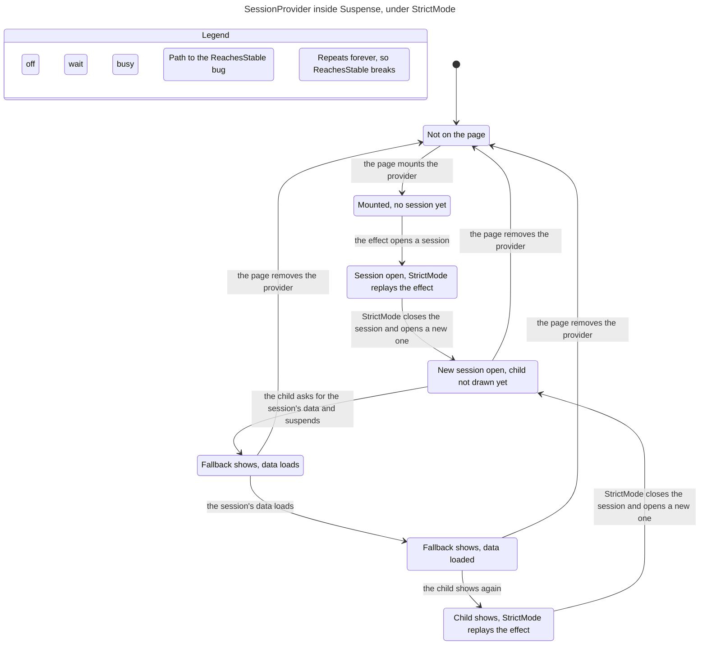

# session-provider

A session's life binds to its React subtree
([ADR 0031](../../decisions/0031-session-lifetime-binds-to-react-subtree.md)).

The spec: a `SessionProvider` inside `<Suspense>`,
under StrictMode.
The child calls `useResource(r)`;
`r` is an async `target: "session"` resource.
It describes commit `3ff6778` (release 0.28.0),
`packages/react/src/index.ts`.

Two configs:

- `SessionProvider.cfg` — StrictMode on.
  `chart.mmd`.
- `nostrict.cfg` — StrictMode off.
  `chart-nostrict.mmd`. All rules hold.

## Rules

TLC reached 16 states (StrictMode on).

- **OneLiveSession** — holds.
  ADR 0031 Decision bullet 2, Consequences bullet 3.
  A mounted provider at rest has one live session,
  the one it holds.
- **ClosedOnce** — holds.
  ADR 0031 Decision bullet 4, Consequences bullet 3.
  Each session is closed at most once.
- **NoLeakAfterUnmount** — holds.
  ADR 0031 Decision bullet 2, Consequences bullet 3.
  After the provider unmounts, no session is live.
- **ReachesStable** — breaks.
  ADR 0031 Context and Decision bullet 4,
  [ADR 0124](../../decisions/0124-a-renderable-resource-renders-through-render.md)
  Lifecycle, card `react/strict-session-suspense`.
  A mounted provider reaches a stable state
  (no build and close loop) while it stays mounted.

## Chart



The chart does not draw "the page above re-renders":
it stays in one chart state.

## The bug

Card `react/strict-session-suspense`.

Tree:

```tsx
<StrictMode>
  <ScopeProvider>
    <Suspense>
      <SessionProvider>
        <Child />
      </SessionProvider>
    </Suspense>
  </ScopeProvider>
</StrictMode>
```

### Path: ReachesStable

1. The page mounts the provider.
   It draws nothing yet.
2. The effect opens session 1.
3. StrictMode closes session 1 and opens session 2.
4. The child asks for session 2's data
   and suspends. The fallback shows.
5. Session 2's data loads.
6. The child shows again.
7. StrictMode closes session 2 and opens session 3.
   React re-runs the effects of content
   that shows again.
8. The child asks for session 3's data
   and suspends. The fallback shows.
9. Session 3's data loads.
10. The child shows again.
11. StrictMode closes session 3 and opens session 4.
    Steps 8 to 11 repeat forever.

Why: the data is per session.
Each reveal makes StrictMode re-run the provider's
effect (`packages/react/src/index.ts:188-199`).
The effect closes the session and opens a new one.
The new session has no data,
so the child suspends again.

## Path test

`paths/session-provider-loop.test.tsx.txt`
goes to `packages/react/tests/statechart/`.

- ReachesStable: fails today.
  By step 11: 4 sessions and 3 builds.
  The card wants 2 and 1.
- The control (same tree, no StrictMode) passes:
  1 session, 1 build, no leak.

Card `react/strict-session-suspense` moves it,
without the `.txt`.

Once moved, run:

```sh
cd packages/react
vp test --project browser \
  tests/statechart/session-provider-loop.test.tsx
```

Code notes, not rules:

- Closing a session waits for a build in flight.
  A build that ignores `ctx.signal` keeps the session
  "closing" after unmount.
- `closeScope` does not await,
  so the old session's close ends
  after the new one opens.
  The spec counts a session as closed
  when its close starts.

## What the spec leaves out

- Async close: Core's drain and `onClose` timing.
- Concurrent renders and transitions.
  Only sync updates.
- A parent scope change, `options`, namespaces,
  errors in the build.
- StrictMode's double render (pure here).
  Two or more providers.
- Build abort and rejection:
  a closed session's build is dropped.
- Session slots recycle (2 slots),
  so the graph is finite.

## Rerun

```sh
cd docs/states/session-provider
statechart SessionProvider.tla \
  --config SessionProvider.cfg \
  --view view.ts --out "$(mktemp -d)"
statechart SessionProvider.tla \
  --config nostrict.cfg \
  --view view.ts --out "$(mktemp -d)"
```

Exit 1 today with StrictMode on: 1 rule breaks.
Exit 0 with StrictMode off.
