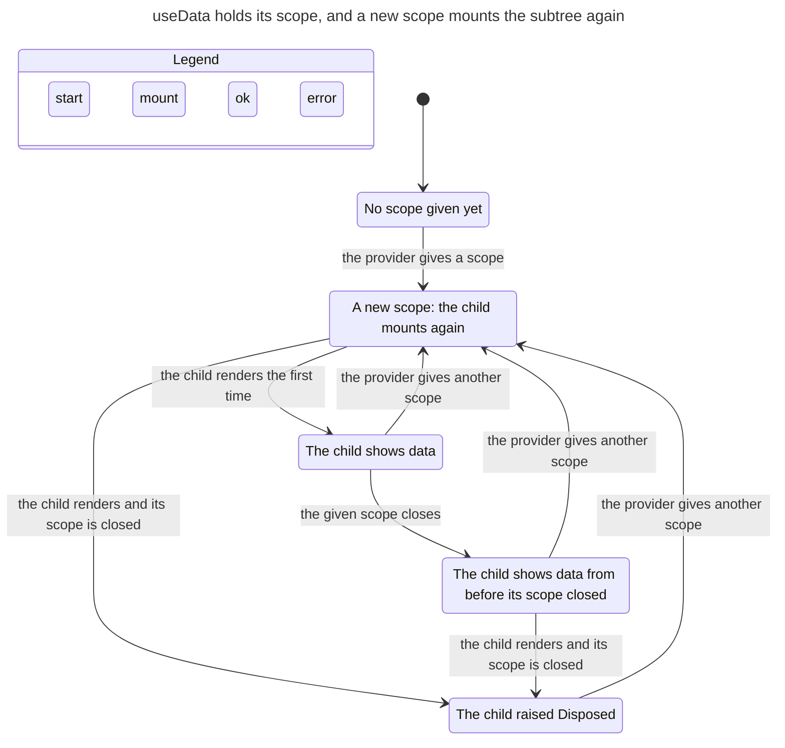

# usedata-scope

`useData` holds its scope;
a new scope mounts the subtree again
([ADR 0144](../../decisions/0144-usedata-holds-its-scope-a-new-scope-mounts-the-subtree-again.md)).

The spec: a `ScopeProvider scope={…}` and one child
that calls `useData`.
It describes commit `3ff6778` (release 0.28.0),
`packages/react/src/index.ts`.

## Rules

TLC reached 36 states. All rules hold.

- **ReadsGivenScope** — holds. ADR 0144 d1 and d2.
  A child never reads from a scope
  other than the one its provider gives now.
- **NewScopeRemounts** — holds. ADR 0144 d2.
  When the provider gives a new scope,
  the child mounts again.
- **ClosedRaisesDisposed** — holds. ADR 0144 d3.
  A render from a closed scope raises `Disposed`;
  it never shows a stale value.
- **NoDeadlock** — holds. From the tool.

## Chart



The chart does not draw these steps
when they stay in one chart state:
"the provider renders with the same scope",
"an old scope closes", "the child renders again".

## Path test

No rule breaks, so there is no bug path.
`paths/usedata-scope-path.test.tsx.txt`
walks the main path on the real code.
It passes today, so the spec matches the code there.

It waits here for now.
It goes to `packages/react/tests/statechart/`
when a card adds the path tests to the packages.

## What the spec leaves out

- Only `ScopeProvider scope={…}`.
  Create mode, a starting scope
  and `SessionProvider` are not in the spec.
  Their keys come from the same `provide()`.
- Concurrent renders:
  "gives now" means the committed prop.
- The ADR 0069 window: during a session's close hooks
  a data cell still reads as before (`hookCanRead`).
  A React render inside that window is left out.
- The selector store, keyed reads, views,
  `useResource`, `useScope`, `useRun`,
  and the server render path.
- How the child renders again after a close;
  any render is enough.

## Rerun

```sh
cd docs/states/usedata-scope
statechart UseDataScope.tla \
  --config UseDataScope.cfg \
  --view view.ts --out "$(mktemp -d)"
```

Exit 0 today: every rule holds.
